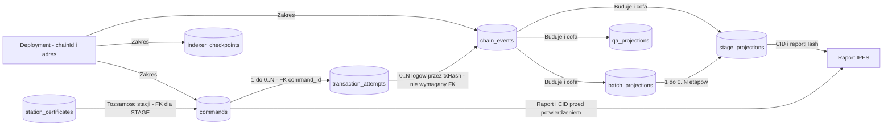
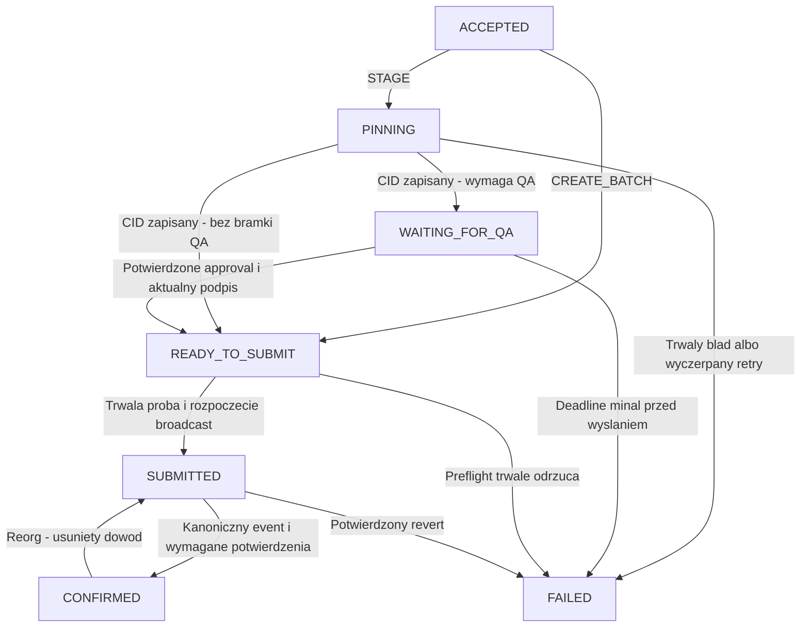
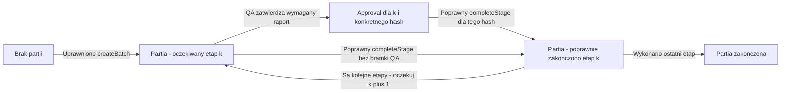

# Dane, relacje i stany

**Status:** logiczny model do implementacji po zatwierdzeniu decyzji.
Nazwy tabel/kolumn to propozycja dla migracji, nie istniejący schemat SQL.
Typy transportowe i podpisy są zdefiniowane w [protocol](protocol.md).
Wybrana marszruta i znaczenie nextStage/completed są w
[production-rules](production-rules.md). [Corrections](corrections.md)
pozostawia recovery otwarte: obecny unique station + nonce nie obsługuje
automatycznie rewizji raportu.

## 1. Gdzie znajdują się dane

| Miejsce | Zawartość | Źródło prawdy / odtwarzanie |
|---|---|---|
| Solidity storage | partia, nextStage, nonce stacji, role, approval dla trójki partia/etap/hash | egzekucja reguł on-chain |
| logi kontraktu | BatchCreated, StageCompleted, approval QA i zmiany ról | publiczna historia z kanonicznych bloków |
| station_certificates | publiczne poświadczenie stacji, wystawca, adres, ważność i odwołanie | off-chain rejestr certyfikatów; nie zastępuje STATION_ROLE |
| IPFS | dokładnie raport v1; bez obwiedni podpisu zmieniającej hash | dane wskazane CID, kontrolowane przez reportHash |
| commands | zamiar, raport/podpis, status i idempotencja | trwałe dane lokalne; nie odbudujesz ich w pełni z chaina |
| transaction_attempts | nonce relayera, signed tx/hash, receipt | lokalna obsługa wysyłania i uzgadniania |
| chain_events / checkpoints | logi i pozycja skanowania | odtwarzalne z RPC od deployment block |
| batch_projections / stage_projections / qa_projections | szybkie widoki potwierdzonych logów | odbudowywalne; nigdy niezależna prawda |

Nie kasuj bazy jako „samego cache”: projekcje są cache, ale zadania i podpisane
próby są danymi operacyjnymi. Zasady backupu i retention wynikają z DEC-11.
Zero-bloat z PDF wyklucza JSON raportów, certyfikaty i kopie podpisów w storage
kontraktu. Role, nonce, nextStage i minimalne approval to stan konieczny
do wykonania wymaganych reguł. Historia szczegółowa pozostaje w IPFS/logach.

## 2. Relacje logiczne

Diagram celowo używa flowchart, aby pokazać także relacje bez FK.
Jedno polecenie ma 0..N prób, jedna próba dotyczy jednego polecenia.
Transakcja może wyemitować wiele logów. BatchCreated nie ma wcześniejszej
projekcji partii, a QA wysłane portfelem może nie mieć lokalnej próby.

<!-- mermaid-checked: no \n, no em-dash/en-dash, no {} in labels, subgraphs are id["label"], arrows are -->|"label"|, all subgraphs closed by end, ids unique -->

### Proponowane rekordy i constraints

| Rekord | Klucz i najważniejsze pola | Ograniczenia |
|---|---|---|
| commands | UUID, chain_id, contract_address, type, owner_address, batch_id, stage_id, station_address, station_nonce, signed_payload_digest, report_json, signature, deadline, cid, status, failure_code, retry_at, lease_owner/until, version | STAGE: unikalne deployment + station + station_nonce; CREATE: unikalne deployment + owner + idempotency_key |
| transaction_attempts | UUID, command_id FK, relayer_address, tx_nonce, tx_hash, signed_tx, calldata_hash, fee parameters, broadcast_at, receipt_block/hash/status | unikalny tx_hash; wiele replacementów może mieć ten sam nonce relayera, ale należą do jednego zamiaru |
| chain_events | deployment, tx_hash, log_index, block_number/hash, tx_index, event_type, payload, canonical | identyfikacja obserwacji obejmuje block_hash; jedna aktywna kanoniczna wersja logicznego logu |
| indexer_checkpoints | deployment, stream, scanned_block_number/hash | jeden aktywny checkpoint na strumień/deployment; zapis razem z zastosowaniem logów |
| batch_projections | deployment + batch_id, next_stage, completed, last_event_position | odbudowa z BatchCreated i kolejnych zdarzeń |
| stage_projections | deployment + batch_id + stage_id, station, cid, report_hash, tx_hash, log_index, block_hash | jeden kanoniczny ukończony etap w liniowej marszrucie |
| qa_projections | deployment + batch_id + stage_id + report_hash, inspector, approval_event, approved | approval jednego hash nie upoważnia do innego raportu |
| station_certificates | certificate_id/serial, station_id, station_address, issuer, signed_certificate, issued_at, expires_at, revoked_at | zaufany wystawca, unikalny serial, adres zgodny ze stacją; FK certificate_id z polecenia STAGE |

Przy wyborze propozycji auth potrzebne są również trwałe rekordy challenge
i sesji: związany adres/domena/deployment, expiry, zużycie challenge,
skrót losowego identyfikatora sesji, ostatnia aktywność i odwołanie.
Parametry i zasady są w [access-control](access-control.md); nie przechowuj
podpisu loginu jako ponownie używalnego tokenu ani ról jako trwałego pozwolenia.
Wybór mechanizmu sesji/CSRF musi poprzedzić migracje tych rekordów.

Pole `inspector` oznacza operatora zmiany z uprawnieniem QA.
Approval on-chain zachowuje jego adres, a `completeStage` wymaga,
by był inny od signera stacji i nadal miał wymaganą rolę.
Zgodność certyfikatu i roli sprawdza się oddzielnie. Pełne poświadczenie
nie jest automatycznie publikowane w paszporcie.

Puste pola zależą od typu polecenia: CREATE_BATCH nie ma report_json/CID,
STAGE ma wymagany raport i podpis. Sprawdź to constraintem i walidacją,
nie dowolnym obiektem z samymi nullable polami.
Signed payload digest identyfikuje zamiar, nie bajty podpisu: różne poprawne
reprezentacje podpisu nie powinny tworzyć drugiej operacji.

### Typy i indeksy

- EVM uint256: `numeric(78,0)` z walidacją `0 <= n < 2^256` albo jawny
  format tekstowy z tym samym sprawdzeniem; nie bigint SQL/Java long.
- Hash/adres: ustalony bytea lub znormalizowany hex z kontrolą długości.
  Stosuj tę samą normalizację w lookup i unique constraints.
- Czas operacyjny: `timestamptz`; timestamp podpisany: Unix seconds bez konwersji
  do milisekund przy hashowaniu.
- Raport może być w jsonb, lecz przy odzyskiwaniu należy ponownie użyć JCS;
  kolejność kluczy jsonb nie jest bajtową tożsamością raportu.
- Indeksy: zadania po status/retry_at/lease_until, historia po deployment,
  batch_id i pozycji `(block_number, tx_index, log_index)`.
- Cursor historii zawiera zakres deploymentu/partii i stabilną pozycję,
  ma limit strony. Po reorg stary cursor może wymagać odświeżenia.
- Logi audytowe zawierają commandId/correlationId i kod błędu; nie JWT/klucze.
  Podpisy i signed_tx w DB są danymi operacyjnymi, nie publicznym payloadem API.

## 3. Stan polecenia

To osobna maszyna od stanu produkcji. Stan FAILED nie oznacza, że cała partia
jest uszkodzona. Polecenie nie przesuwa produkcji przed kanonicznym eventem.

<!-- mermaid-checked: no \n, no em-dash/en-dash, no {} in labels, subgraphs are id["label"], arrows are -->|"label"|, all subgraphs closed by end, ids unique -->

| Status | Co jest już trwałe | Dalsza akcja |
|---|---|---|
| ACCEPTED | raport lub create payload, owner i idempotencja | worker przejmuje lease |
| PINNING | raport, podpis i etap operacji | pinowanie lub retry tego samego raportu |
| WAITING_FOR_QA | CID, hash, deadline | inspekcja; bez przydziału nonce relayera |
| READY_TO_SUBMIT | dane kompletne, wstępne warunki sprawdzone | ponowny preflight, przydział nonce i zapis próby |
| SUBMITTED | podpisana próba/hash/nonce zapisana, nawet gdy odpowiedź send zaginęła | uzgodnienie broadcast/receipt; nie tworzyć nowego zamiaru |
| CONFIRMED | efekt na kanonicznym chainie oraz aktualna projekcja | odczyt; możliwy kontrolowany rollback po reorg |
| FAILED | znana, konkretna przyczyna | jawna procedura operatora; nie zwykła automatyczna mutacja podpisu |

Przy awarii między zapisem próby a zmianą statusu recovery sprawdza próby
niezależnie od statusu polecenia. Zapis próby, rezerwacja nonce i przejście
do SUBMITTED powinny należeć do jednej krótkiej transakcji DB przed broadcast.
Podpisane bajty pozwalają wysłać identyczną próbę po restarcie.
SUBMITTED o nieznanym wyniku nie może przejść do FAILED wyłącznie przez timeout.
Reorg zatwierdzonego wcześniej revertu też wymaga ponownego uzgodnienia próby.

## 4. Stan produkcji i ręczne QA

Nie zamrażamy tu konkretnej liczby etapów: `k` to nextStage z marszruty DEC-01.
Ostatni etap ustawia completed; kolejne zgłoszenia są zabronione.

<!-- mermaid-checked: no \n, no em-dash/en-dash, no {} in labels, subgraphs are id["label"], arrows are -->|"label"|, all subgraphs closed by end, ids unique -->

Approval jest dodatkowym stanem autoryzacji operatora zmiany, nie ukończeniem etapu.
Politykę powtórzeń i zastąpienia approval opisuje
[quality-approval](quality-approval.md); aktualna rola to nie trwałe unieważnienie.
Na bramce kontroli wymagane są oba niezależne klucze; nie wystarcza boolean
ustawiony przez tę samą stację.
Kontrakt wymaga `qaPassed=true`, podpisu/roli stacji, właściwego nonce,
deadline i oczekiwanego etapu. Nie zna pełnych pomiarów z IPFS:
kontrolę ich progów wykonuje backend/stacja/QA. Bez zmiany protokołu nie wolno
twierdzić, że kontrakt sam zweryfikował temperaturę ukrytą pod reportHash.

## 5. Transakcje, konkurencja i reorg

1. Atomowy zapis przyjęcia: polecenie i tożsamość idempotencji.
2. Pobranie zadania: lock/lease z czasem ważności; I/O poza transakcją.
3. Atomowy zapis próby: przypisanie nonce relayera, signed_tx/hash i status.
4. Atomowy zapis indexera: kanoniczne logi, projekcje, statusy i checkpoint.
5. Reorg: znajdź wspólnego przodka, odznacz niekanoniczne logi, odtwórz projekcje,
   przelicz powiązane statusy; dopiero potem kontynuuj skanowanie.

Lease chroni zadanie, nie zastępuje globalnej synchronizacji nonce konta.
MVP działa z jednym writerem; uruchomienie drugiej instancji bez wspólnego
mechanizmu rezerwacji musi być zabronione operacyjnie.
Checkpoint trzyma hash również dla bloków bez logów, aby wykrywać zmianę gałęzi.
Po reorg historyczny event zachowany do audytu nie jest prezentowany jako aktywny.
