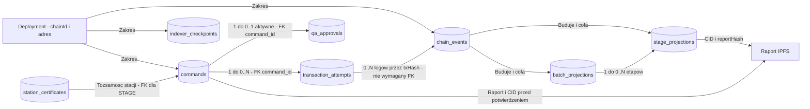
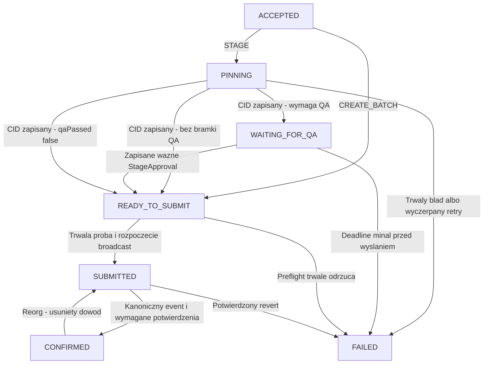
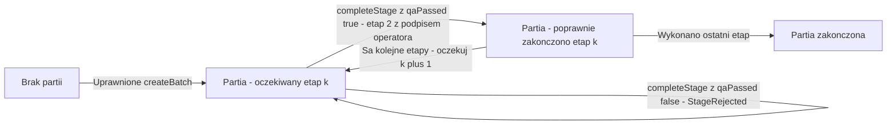

# Dane, relacje i stany

**Status:** logiczny model do implementacji po potwierdzeniu decyzji (zmiany [v2](changes-v2.md)).
Nazwy tabel/kolumn to propozycja dla migracji, nie istniejący schemat SQL.
Typy transportowe i podpisy są zdefiniowane w [protocol](protocol.md).
Wybrana marszruta i znaczenie nextStage/completed są w
[production-rules](production-rules.md). Wznowienie po błędzie opisuje
[corrections](corrections.md) (reguła zastępowania, bez nonce stacji).

## 1. Gdzie znajdują się dane

| Miejsce | Zawartość | Źródło prawdy / odtwarzanie |
|---|---|---|
| Solidity storage | partia (exists, nextStage, completed), rejestr stacji (active, expiresAt, stageMask), role, `maxDeadlineWindow`, skróty zapisanych odrzuceń | egzekucja reguł on-chain |
| logi kontraktu | BatchCreated, StageCompleted (z qaOperator), StageRejected, StationRegistered/Revoked | publiczna historia z kanonicznych bloków |
| station_certificates | publiczne poświadczenie stacji (payload + podpis wystawcy), status zgodności z rejestrem | off-chain poświadczenie audytowe; egzekucję daje rejestr on-chain |
| IPFS | dokładnie raport v1 (bajty JCS); bez obwiedni podpisu zmieniającej hash | dane wskazane CID, kontrolowane przez reportHash |
| commands | zamiar, raport/podpis, status, outcome i idempotencja | trwałe dane lokalne; nie odbudujesz ich w pełni z chaina |
| qa_approvals | podpis `StageApproval` operatora zebrany przez API | trwałe dane lokalne (podpis jest też w calldata po wykonaniu) |
| transaction_attempts | nonce relayera, signed tx/hash, receipt | lokalna obsługa wysyłania i uzgadniania |
| auth_challenges / auth_sessions | challenge SIWE i skróty tokenów Bearer | dane operacyjne, wygasają |
| chain_events / checkpoints | logi i pozycja skanowania | odtwarzalne z RPC od deployment block |
| batch_projections / stage_projections | szybkie widoki potwierdzonych logów (ukończone i odrzucone etapy) | odbudowywalne; nigdy niezależna prawda |

Nie kasuj bazy jako „samego cache”: projekcje są cache, ale zadania, approval i podpisane
próby są danymi operacyjnymi. Zasady backupu i retention wynikają z DEC-11.
Zero-bloat z PDF wyklucza JSON raportów, certyfikaty i kopie podpisów w storage
kontraktu. Role, rejestr stacji, nextStage i skróty odrzuceń to stan konieczny
do wykonania wymaganych reguł. Historia szczegółowa pozostaje w IPFS/logach.

## 2. Relacje logiczne

Diagram celowo używa flowchart, aby pokazać także relacje bez FK.
Jedno polecenie ma 0..N prób, jedna próba dotyczy jednego polecenia.
Transakcja może wyemitować wiele logów. BatchCreated nie ma wcześniejszej
projekcji partii, a QA wysłane portfelem może nie mieć lokalnej próby.

<!-- mermaid-checked: no \n, no em-dash/en-dash, no {} in labels, subgraphs are id["label"], arrows are -->|"label"|, all subgraphs closed by end, ids unique -->

### Proponowane rekordy i constraints

| Rekord | Klucz i najważniejsze pola | Ograniczenia |
|---|---|---|
| commands | UUID, chain_id, contract_address, type, owner_address, batch_id, batch_number, stage_id, station_address, signed_payload_digest, report_json, signature, deadline, cid, status, outcome (ACCEPTED/REJECTED), failure_code, retry_at, retry_allowed_after, lease_owner/until, version | STAGE: unikalny digest w deployment; częściowy unikalny indeks `(deployment, batch_id, stage_id)` dla poleceń aktywnych lub CONFIRMED/ACCEPTED (reguła zastępowania z [corrections](corrections.md)); CREATE: unikalne deployment + owner + idempotency_key |
| qa_approvals | UUID, command_id FK, operator_address, approval_deadline, signature, created_at, status | jedno aktywne ważne approval na polecenie; ten sam operator idempotentnie, inny operator przy ważnym approval: konflikt |
| transaction_attempts | UUID, command_id FK, relayer_address, tx_nonce, tx_hash, signed_tx, calldata_hash, fee parameters, broadcast_at, receipt_block/hash/status | unikalny tx_hash; ponowne wysłanie dotyczy identycznych bajtów (bez fee-bump w MVP) |
| auth_challenges / auth_sessions | challenge: adres, domena, nonce SIWE, expiry, used_at; sesja: skrót SHA-256 tokenu, adres, expiry, last_seen, revoked_at | challenge jednorazowy i atomowo zużywany; w bazie tylko skrót tokenu |
| chain_events | deployment, tx_hash, log_index, block_number/hash, tx_index, event_type, payload, canonical | identyfikacja obserwacji obejmuje block_hash; jedna aktywna kanoniczna wersja logicznego logu |
| indexer_checkpoints | deployment, stream, scanned_block_number/hash | jeden aktywny checkpoint na strumień/deployment; zapis razem z zastosowaniem logów |
| batch_projections | deployment + batch_id, batch_number, next_stage, completed, last_event_position | odbudowa z BatchCreated i kolejnych zdarzeń |
| stage_projections | deployment + batch_id + stage_id + report_hash, outcome (COMPLETED/REJECTED), station, qa_operator, cid, tx_hash, log_index, block_hash | jeden kanoniczny COMPLETED na etap w liniowej marszrucie; REJECTED może być wiele |
| station_certificates | certificate_id/serial, station_id, station_address, issuer, signed_certificate, issued_at, expires_at, allowed_stage_ids, chain_sync_status | zaufany wystawca, unikalny serial; FK certificate_id z polecenia STAGE; ACTIVE tylko gdy zgodny z rejestrem on-chain |

Rekordy challenge i sesji (V2-06): losowy token Bearer jest zwracany raz,
w bazie zostaje tylko jego skrót, ostatnia aktywność i odwołanie.
Parametry i zasady są w [access-control](access-control.md); nie przechowuj
podpisu loginu jako ponownie używalnego tokenu ani ról jako trwałego pozwolenia.

Pole `qa_operator` oznacza operatora zmiany z uprawnieniem QA, odczytanego ze
zdarzenia `StageCompleted`. Kontrakt wymaga, by był różny od signera stacji
i nadal miał wymaganą rolę. Zgodność certyfikatu z rejestrem on-chain sprawdza się
oddzielnie. Pełne poświadczenie nie jest automatycznie publikowane w paszporcie.

Puste pola zależą od typu polecenia: CREATE_BATCH nie ma report_json/CID,
STAGE ma wymagany raport i podpis. Sprawdź to constraintem i walidacją,
nie dowolnym obiektem z samymi nullable polami.
Signed payload digest identyfikuje zamiar, nie bajty podpisu: różne poprawne
reprezentacje podpisu nie powinny tworzyć drugiej operacji.

### Typy i indeksy

- EVM uint256: `numeric(78,0)` z walidacją `0 <= n < 2^256` albo jawny
  format tekstowy z tym samym sprawdzeniem; nie bigint SQL/Java long.
- Hash/adres: ustalony bytea lub znormalizowany hex z kontrolą długości.
  Stosuj tę samą normalizację w lookup i unique constraints.
- Czas operacyjny: `timestamptz`; timestamp podpisany: Unix seconds bez konwersji
  do milisekund przy hashowaniu.
- Raport może być w jsonb, lecz przy odzyskiwaniu należy ponownie użyć JCS;
  kolejność kluczy jsonb nie jest bajtową tożsamością raportu.
- Indeksy: zadania po status/retry_at/lease_until, historia po deployment,
  batch_id i pozycji `(block_number, tx_index, log_index)`.
- Cursor historii zawiera zakres deploymentu/partii i stabilną pozycję,
  ma limit strony. Po reorg stary cursor może wymagać odświeżenia.
- Logi audytowe zawierają commandId/correlationId i kod błędu; nie JWT/klucze.
  Podpisy i signed_tx w DB są danymi operacyjnymi, nie publicznym payloadem API.

## 3. Stan polecenia

To osobna maszyna od stanu produkcji. Stan FAILED nie oznacza, że cała partia
jest uszkodzona. Polecenie nie przesuwa produkcji przed kanonicznym eventem.

<!-- mermaid-checked: no \n, no em-dash/en-dash, no {} in labels, subgraphs are id["label"], arrows are -->|"label"|, all subgraphs closed by end, ids unique -->

| Status | Co jest już trwałe | Dalsza akcja |
|---|---|---|
| ACCEPTED | raport lub create payload, owner i idempotencja | worker przejmuje lease |
| PINNING | raport, podpis i etap operacji | pinowanie lub retry tego samego raportu |
| WAITING_FOR_QA | CID, hash, deadline | czekanie na `StageApproval` operatora; bez przydziału nonce relayera |
| READY_TO_SUBMIT | dane kompletne (dla etapu 2 także approval), wstępne warunki sprawdzone | ponowny preflight, przydział nonce i zapis próby |
| SUBMITTED | podpisana próba/hash/nonce zapisana, nawet gdy odpowiedź send zaginęła | uzgodnienie broadcast/receipt; nie tworzyć nowego zamiaru |
| CONFIRMED | efekt na kanonicznym chainie oraz aktualna projekcja; `outcome` ACCEPTED (`StageCompleted`) lub REJECTED (`StageRejected`) | odczyt; możliwy kontrolowany rollback po reorg |
| FAILED | znana, konkretna przyczyna; pole `retry_allowed_after` | nowy raport według reguły zastępowania ([corrections](corrections.md)); nie mutacja podpisu |

Przy awarii między zapisem próby a zmianą statusu recovery sprawdza próby
niezależnie od statusu polecenia. Zapis próby, rezerwacja nonce i przejście
do SUBMITTED powinny należeć do jednej krótkiej transakcji DB przed broadcast.
Podpisane bajty pozwalają wysłać identyczną próbę po restarcie.
SUBMITTED o nieznanym wyniku nie może przejść do FAILED wyłącznie przez timeout.
Reorg zatwierdzonego wcześniej revertu też wymaga ponownego uzgodnienia próby.

## 4. Stan produkcji i ręczne QA

Nie zamrażamy tu konkretnej liczby etapów: `k` to nextStage z marszruty DEC-01.
Ostatni etap ustawia completed; kolejne zgłoszenia są zabronione.

<!-- mermaid-checked: no \n, no em-dash/en-dash, no {} in labels, subgraphs are id["label"], arrows are -->|"label"|, all subgraphs closed by end, ids unique -->

Approval operatora nie jest stanem łańcucha: to podpis przekazany do `completeStage`,
który nie ma żadnego skutku bez wykonania etapu. Zasady: [quality-approval](quality-approval.md).
Na bramce kontroli wymagane są oba niezależne klucze; nie wystarcza boolean
ustawiony przez tę samą stację.
Kontrakt wymaga `qaPassed=true` (inaczej tylko `StageRejected`), podpisu stacji
aktywnej w rejestrze, deadline w oknie i oczekiwanego etapu. Nie zna pełnych
pomiarów z IPFS: kontrolę ich progów wykonuje backend/stacja/QA. Bez zmiany
protokołu nie wolno twierdzić, że kontrakt sam zweryfikował temperaturę ukrytą
pod reportHash.

## 5. Transakcje, konkurencja i reorg

1. Atomowy zapis przyjęcia: polecenie i tożsamość idempotencji.
2. Pobranie zadania: lock/lease z czasem ważności (`FOR UPDATE SKIP LOCKED`); I/O poza transakcją.
3. Atomowy zapis próby: przypisanie nonce relayera, signed_tx/hash i status.
4. Atomowy zapis indexera: kanoniczne logi, projekcje, statusy i checkpoint.
5. Reorg (V2-08): indexer przetwarza bloki z głębokością potwierdzeń N i przy każdym
   cyklu ponownie skanuje okno ostatnich N bloków, porównując block hash.
   Przy niezgodności odznacza niekanoniczne logi okna, ponownie je wczytuje i
   przelicza projekcje oraz statusy; dopiero potem kontynuuje.
   Pełnej odbudowy od deployment block wymaga tylko zmiana ścieżki deployment
   albo reorg głębszy niż N.

Lease chroni zadanie, nie zastępuje globalnej synchronizacji nonce konta.
MVP działa z jednym writerem; uruchomienie drugiej instancji bez wspólnego
mechanizmu rezerwacji musi być zabronione operacyjnie.
Checkpoint trzyma hash również dla bloków bez logów, aby wykrywać zmianę gałęzi.
Po reorg historyczny event zachowany do audytu nie jest prezentowany jako aktywny.
Test reorg: Anvil `evm_snapshot` i `evm_revert`.
