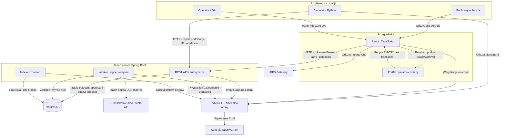
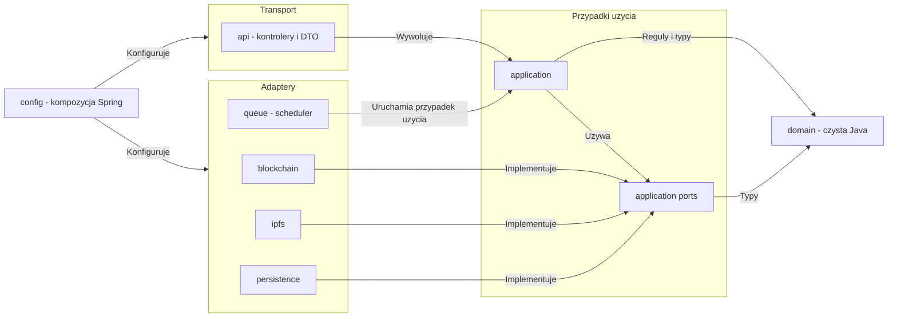
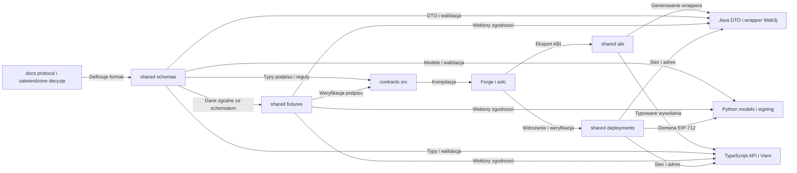

# Mapa systemu i zależności

To **projekt docelowy**, nie diagram istniejącego kodu. Czytaj razem z
[architekturą](architecture.md), [decyzjami](decisions.md) i
[przepływami](flows.md). Mermaid renderuje się w podglądzie Markdown
obsługującym Mermaid oraz na GitHubie.
Nadrzędny zakres opisuje [mapa PDF](source-alignment.md). QA oznacza operatora
zmiany; jego niezależny podpis `StageApproval` współautoryzuje zamknięcie kontroli.
Rejestr stacji jest on-chain, certyfikaty są off-chain (poświadczenie audytowe),
a nie nową fizyczną infrastrukturą. Zmiany v2: [changes-v2](changes-v2.md).

## 1. Architektura aplikacji

Strzałka oznacza inicjatora wywołania, a nie kierunek importu.
Odpowiedź wraca tym samym połączeniem. Indexer odpytuje RPC; kontrakt
nie wywołuje HTTP do backendu.

<!-- mermaid-checked: no \n, no em-dash/en-dash, no {} in labels, subgraphs are id["label"], arrows are -->|"label"|, all subgraphs closed by end, ids unique -->

### Technologie i procesy

| Warstwa | Technologia / wersja bazowa | Rola |
|---|---|---|
| Kontrakt | Solidity 0.8.24+ (jawny `evm_version`), OpenZeppelin, Foundry | reguły i ostateczna autoryzacja etapów |
| Backend | Java 21, Spring Boot (aktualna wspierana wersja), Maven, Web3j (tylko kodowanie i podpis) | API, trwałe polecenia, relayer i indexer |
| Baza | PostgreSQL + Flyway + JPA | zadania, próby, approval, projekcje i checkpoint |
| Symulator | Python 3.11+, Pydantic, eth-account, httpx | podpisane dane i scenariusze |
| Frontend | React 18/19, TypeScript, Vite, Wagmi v2/Viem | UI, podpis approval operatora i paszport |
| Raporty | Kubo (lokalnie, CI) i Pinata (demo), publiczny gateway IPFS | zapis i odczyt JSON |
| Sieć | Anvil 31337 / Polygon Amoy 80002 | lokalna i testowa egzekucja EVM |

Dokładne wersje są do przypięcia podczas inicjalizacji, nie wynikają ze znaku `+`.
Nie ma osobnego serwera kolejek i osobnego mikroserwisu indexera.
Magazyn raportów zapisuje dane, gateway je odczytuje; brak strzałki między nimi oznacza,
że replikacji IPFS nie implementujemy we własnym kodzie.

## 2. Zależności kodu backendu

Tutaj strzałka oznacza zależność/import albo implementację wskazanego interfejsu,
**nie** fizyczne wywołanie HTTP. W runtime aplikacja wywoła port, a Spring
podstawi adapter. Pozwala to testować przypadki użycia bez RPC i Pinaty.

<!-- mermaid-checked: no \n, no em-dash/en-dash, no {} in labels, subgraphs are id["label"], arrows are -->|"label"|, all subgraphs closed by end, ids unique -->

### Inwentarz komponentów

| Komponent | Odpowiedzialność | Zabroniony skrót |
|---|---|---|
| BatchController / CommandController | walidacja HTTP, kontekst tożsamości, wywołanie use case | Web3j lub JPA bezpośrednio w kontrolerze |
| SubmitStageUseCase | spójność raportu, podpis, idempotencja, trwałe przyjęcie | HTTP 202 przed zatwierdzeniem zapisu DB |
| ProcessStageCommand | kroki pinowania, QA i wysłania | jedna długa transakcja SQL obejmująca RPC |
| ChainGateway / ReportStorage | interfejsy aplikacji | Web3j Response w modelu domenowym |
| Web3jChainGateway | kodowanie ABI, odczyt ról/rejestru, podpis i wysyłka tx, receipt/logi | `.send()`/`DefaultGasProvider`, uznanie timeout za dowód niewysłania |
| ReportStorage (Kubo/Pinata) | zapis bajtów JCS i walidacja CID (v0/v1) | sukces z pustym CID |
| CommandRepository | trwałość i constraints | deduplikacja wyłącznie w pamięci |
| RelayerWorker | lease, wznawianie i pojedynczy writer | wielowątkowe przydzielanie nonce konta |
| ChainEventIndexer | kanoniczna historia, checkpoint, okno ponownego skanu | brak cofania projekcji po reorg |
| domain | typy i invariants | zależność od Spring/JPA/Web3j |

## 3. Zależności buildów i formatów

Strzałki oznaczają **co powstaje z czego**. To nie ruch sieciowy.
Shared nie jest piątym serwisem i nie uruchamia procesu.

<!-- mermaid-checked: no \n, no em-dash/en-dash, no {} in labels, subgraphs are id["label"], arrows are -->|"label"|, all subgraphs closed by end, ids unique -->

Generowane klasy Java trafiają do `backend/target/generated-sources/`,
nie do ręcznie utrzymywanego modelu; wrapper służy do kodowania wywołań
(bez `.send()`). Po zmianie podpisywanego pola trzeba
zaktualizować wszystkie cztery moduły, nie tylko schema JSON.
Zmiana adresu wdrożenia wymaga nowej domeny; stary podpis nie przejdzie.

## 4. Katalog połączeń runtime

Porty to lokalna propozycja, nie sztywne adresy w kodzie. API używa tokenu Bearer,
więc lokalnie wystarcza HTTP; HTTPS jest potrzebny frontendowi (kamera/QR).
API wewnątrz jednego procesu nie potrzebuje brokera ani połączenia HTTP.

| Inicjator -> odbiorca | Protokół / lokalny port | Dane | Uprawnienie i błąd |
|---|---|---|---|
| przeglądarka -> frontend | HTTPS 5173 (lokalny certyfikat deweloperski) | pliki SPA | publiczne; błąd ładowania |
| frontend -> backend | REST JSON 8080 | odczyty, tworzenie partii, prywatne statusy, `POST approval` | token Bearer dla zapisu/statusu; Problem Details |
| symulator -> backend | REST JSON 8080 | raport + EIP-712, login/status | podpis stacji; token Bearer dla prywatnego GET |
| symulator -> RPC | JSON-RPC 8545 | odczyt stanu partii i domeny | brak klucza relayera; jawny błąd RPC |
| backend -> PostgreSQL | PostgreSQL 5432 | zadania, próby, approval, projekcja | osobne konto bazy, brak publicznego portu w deploymencie |
| backend -> magazyn raportów | Kubo API (lokalnie, port do weryfikacji) / Pinata HTTPS 443 | bajty JCS raportu | JWT Pinaty tylko na serwerze; timeout/401/429/5xx |
| backend -> RPC | JSON-RPC 8545 / HTTPS 443 | role, rejestr stacji, stan, tx, receipt, logi | klucz relayera tylko do podpisu; RPC nigdy nie dostaje go jako JSON |
| portfel operatora zmiany -> frontend | `eth_signTypedData_v4` | podpis `StageApproval` | QA_INSPECTOR_ROLE, inny adres niż stacja; bez transakcji i gazu |
| frontend -> gateway | HTTP lokalnie / HTTPS 443 | raport z CID | publiczne; limit rozmiaru, hash i schema |
| frontend -> RPC | JSON-RPC | niezależny odczyt stanu/logu | publiczny endpoint bez prywatnego tokenu w buildzie |

## 5. Co zmiana może zepsuć

| Zmieniany element | Konsumenci do aktualizacji | Dowód zgodności |
|---|---|---|
| etapy/QA | kontrakt, backend, symulator, UI | te same scenariusze i oczekiwany nextStage |
| schema raportu / JCS | Python, Java, TypeScript | identyczny hash fixture |
| EIP-712 (`StageCompletion`, `StageApproval`) | Solidity, Python, Java, TS | jeden signer we wspólnym wektorze |
| ABI / events | wrapper Java, Viem, indexer | lokalny deployment i odczyt logów |
| OpenAPI | kontrolery, klient frontendowy, symulator | walidacja request/response |
| sieć/adres kontraktu | cała czwórka modułów | chainId i domena zgodne z deploymentem |
| migracje DB | API, worker i indexer | upgrade pustej i istniejącej bazy |
| status polecenia | API, worker, polling i UI QA | każdy status ma prezentację i regułę retry |
| rejestr stacji / certyfikat / wystawca | kontrakt, rejestr backendu, symulator, administracja | zgodny signer, ważność, `stageMask`, odwołanie |
