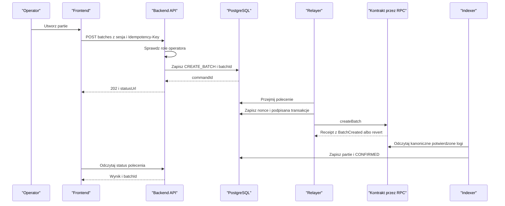
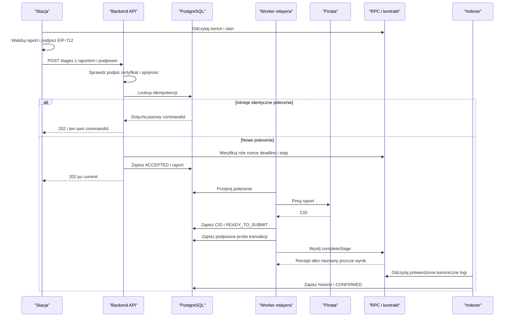
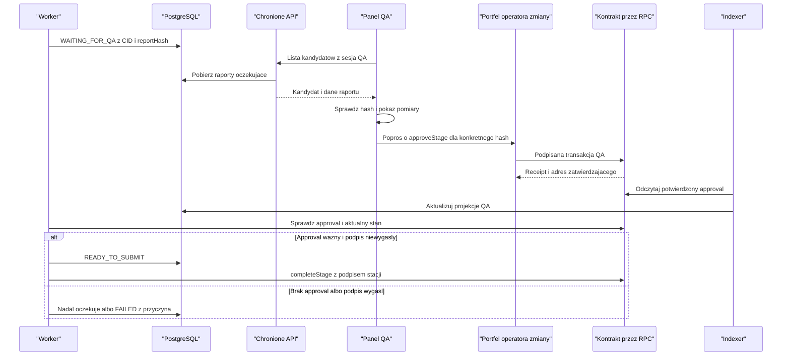
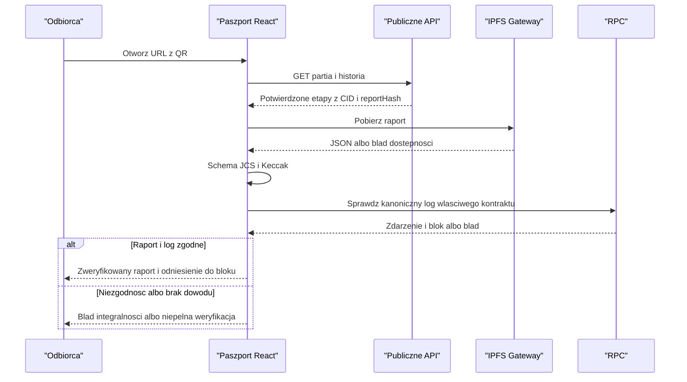

# Przepływy od kliknięcia do potwierdzenia

**Status:** projekt wykonania, zgodny z [protokołem](protocol.md).
Rozszerzenia QA/auth z tego dokumentu wymagają zatwierdzenia
[DEC-04..06](decisions.md) i dopisania do OpenAPI przed implementacją.
QA oznacza operatora zmiany uprawnionego do kontroli, nie dodatkową osobę.
Wymóg drugiego klucza i certyfikatu stacji pochodzi z PDF; jedynie szczegóły
techniczne realizacji są propozycją.
Strzałki sekwencji oznaczają wywołania i odpowiedzi, nie importy.
Dokładne warunki etapów ustala [production-rules](production-rules.md),
politykę approval [quality-approval](quality-approval.md), a role i sesje
[access-control](access-control.md). Alternatywy poprawek są w
[corrections](corrections.md), bez wybranego recovery.

## 1. Przygotowanie środowiska

1. Uruchom PostgreSQL i Anvil; sprawdź health, RPC chainId i dostępność bazy.
2. Wykonaj migracje. Wdróż kontrakt i zapisz adres, deployment block i ABI.
3. Admin wystawia/rejestruje certyfikaty stacji i nadaje role relayerowi,
   stacjom oraz operatorom (w tym operatorowi zmiany z QA) według DEC-06/13.
4. Każdy moduł dostaje tę samą domenę, sieć, adres i uzgodnioną marszrutę.
5. Backend sprawdza dostęp do DB, zgodność sieci/kontraktu i zależności.
6. Frontend i symulator uruchamiają się dopiero po gotowości API.

Anvil po resecie to nowy stan: nie zostawiaj starej bazy/projekcji udającej
ciągłość. Użyj odizolowanego środowiska lub jawnego resetu i ponownej indeksacji.
Nie usuwaj wolumenów automatycznie.

## 2. Tworzenie partii

Proponowana autoryzacja: operator loguje się challenge, a API sprawdza rolę.
Relayer tworzy partię on-chain, więc kontrakt autoryzuje jego konto.
Audyt powiązania operatora z poleceniem pozostaje w backendzie.
Jeżeli ma być dowodzony także on-chain, potrzebny jest odrębny podpis operatora
i zmiana interfejsu; nie zapewnia tego sam `msg.sender` relayera.

<!-- mermaid-checked: every participant uses `participant Id as "Label"`, no \n in aliases/messages/notes, every alt/opt/loop closed by end, no `:` inside any alias -->

Polecenie CREATE_BATCH pomija pinowanie i QA. Przed potwierdzeniem partia
może być widoczna w prywatnym statusie, nie jako ukończone utworzenie
w publicznej projekcji. Ponowny Idempotency-Key z tą samą treścią wskazuje
ten sam commandId i batchId; z inną treścią daje konflikt.

## 3. Zgłoszenie etapu bez ręcznej bramki QA

1. Symulator czeka na poprzedni etap i czyta nonce stacji z kontraktu.
2. Buduje raport, waliduje, kanonizuje, liczy hash i podpisuje StageCompletion.
3. API sprawdza format, path/body, hash, podpis, aktywny certyfikat zgodny
   z adresem stacji, rolę, deadline i reguły wstępne.
4. Identyczny wcześniejszy podpisany zamiar zwraca istniejące polecenie.
   Lookup istniejącego polecenia następuje po uwierzytelnieniu/weryfikacji
   dowodu stacji, lecz **przed** odrzuceniem za nonce/deadline zużyte przez ten
   sam zamiar. Inaczej retry po sukcesie mylnie dawałby konflikt.
5. Nowy zamiar przechodzi pełne sprawdzenie bieżącego nonce/deadline i jest
   zapisany atomowo wraz z idempotencją.
6. Worker pinując zapisuje CID, potem weryfikuje aktualny stan, deadline i QA.
7. Jeden writer przygotowuje, podpisuje i zapisuje transakcję, potem ją wysyła.
8. Receipt sukcesu nie jest jeszcze potwierdzeniem projekcji.
9. Indexer po wymaganej liczbie bloków zapisuje historię i CONFIRMED atomowo
   z checkpointem. Frontend odświeża partię i historię.

<!-- mermaid-checked: every participant uses `participant Id as "Label"`, no \n in aliases/messages/notes, every alt/opt/loop closed by end, no `:` inside any alias -->

Przy równoczesnym identycznym POST oba requesty mogą minąć lookup:
constraint DB rozstrzyga wyścig. Po naruszeniu unikalności odczytaj zwycięskie
polecenie i porównaj podpisywane pola; nie zwracaj ślepego sukcesu.
Uwierzytelnienie prywatnego GET statusu opisuje sekcja 7.

## 4. Dwa klucze przy zamknięciu kontroli - wariant wykonawczy

PDF wymaga podpisu maszyny/czujnika i operatora zmiany. W tym wariancie
podpis stacji to EIP-712 raportu, a drugi podpis to transakcja operatora
zatwierdzająca ten sam raport. Operator ma techniczną rolę QA_INSPECTOR_ROLE.
To obowiązkowa bramka dla etapu kontroli, nie opcjonalny trzeci audyt.

Raport z `qaPassed=false` jest odrzucany z `422`; nie trafia do kolejki
zatwierdzania i nie może zostać zalegalizowany przez inspektora.
Jeśli pomiary są poprawne, ale etap wymaga ręcznego QA:

1. Przyjmij i przypnij raport jak wyżej. Zapisz `WAITING_FOR_QA`, CID i hash.
2. Udostępnij kandydata tylko uprawnionej obsłudze/QA. Nie jest publiczną historią.
3. QA sprawdza tożsamość stacji, raport, jego hash i wybraną partię/etap.
4. Portfel wysyła `approveStage(batchId, stageId, reportHash)` według przyszłego ABI.
5. Kontrakt sprawdza rolę QA, istnienie partii, aktualny etap i brak ukończenia.
   Wiąże approval z pełną trójką i adresem operatora, emituje zdarzenie.
6. Backend widzi kanoniczne potwierdzenie approval; worker ponownie czyta
   stan/approval/deadline i może przejść do READY_TO_SUBMIT.
7. `completeStage` sam sprawdza approval. Cofnięcie/zniknięcie approval przez
   reorg nie może być obchodzone przez cache backendu. Odzyskany signer stacji
   i zapisany signer approval muszą być różnymi adresami; aktualne role
   obu muszą pozwalać na zamknięcie kontroli.

<!-- mermaid-checked: every participant uses `participant Id as "Label"`, no \n in aliases/messages/notes, every alt/opt/loop closed by end, no `:` inside any alias -->

### Proponowane uzupełnienie API dla QA

| Metoda / ścieżka | Dostęp | Wynik |
|---|---|---|
| `GET /api/v1/qa/candidates` | aktualna rola QA | paginowana lista WAITING_FOR_QA, bez sekretów/signature |
| `GET /api/v1/qa/candidates/{commandId}` | QA lub właściciel polecenia | raport, CID, hash, partia/etap, deadline i aktualność |

Brak `POST /qa/approve` w bazowym wariancie: transakcję podpisuje i opłaca
operator zmiany z uprawnieniem QA.
W MVP brak osobnej trwałej decyzji „odrzucono przez QA”: odmowa nie daje approval,
polecenie czeka do wygaśnięcia. Osobna decyzja odrzucenia/wymiana raportu
wymaga zaplanowania zdarzeń i procedury DEC-09, nie cichej edycji kandydata.

## 5. Publiczny paszport i integralność

<!-- mermaid-checked: every participant uses `participant Id as "Label"`, no \n in aliases/messages/notes, every alt/opt/loop closed by end, no `:` inside any alias -->

Sprawdzenie on-chain obejmuje właściwą sieć/adres kontraktu, tx receipt
z sukcesem, logIndex, batchId, stageId, reportHash i kanoniczny blockHash,
przy tej samej polityce potwierdzeń co API. Nie wystarczy dowolny log z takim hash.

UI rozróżnia:
- **Dane API:** odczytano projekcję; nie wykonano niezależnego sprawdzenia.
- **Integralność zgodna:** JSON zgadza się z hashem API, lecz brak niezależnego RPC.
- **Zweryfikowano on-chain:** porównano raport z kanonicznym zdarzeniem.
- **Błąd integralności:** hash/schemat niezgodny.
- **Nie można zweryfikować:** brak RPC/gateway; to nie jest potwierdzenie ani
  dowód fałszerstwa.

## 6. Awarie i decyzja o ponowieniu

| Punkt awarii | Co jest trwałe | Co robić |
|---|---|---|
| przed commit API | brak zaakceptowanego commandId | klient ponawia identyczny zamiar; idempotencja rozstrzyga nieznany wynik |
| po commit, przed odpowiedzią | polecenie | identyczny POST zwraca istniejący commandId |
| pinowanie timeout | raport i etap polecenia, CID może być jeszcze nieznany | sprawdź/ponów pinowanie tej samej treści z backoff; nie twórz nowego command |
| CID zapisany, proces padł | raport i CID | wznowienie nie musi ponownie pinować |
| tx zapisana, przed broadcast | nonce i podpisane bajty/hash | wyślij tę samą transakcję |
| timeout send / brak receipt | tx hash i nonce | uzgadniaj transakcję; brak receipt nie oznacza FAILED |
| receipt revert | znany skutek i zużyty nonce konta relayera | FAILED; nonce stacji przy rewercie nie wzrósł |
| deadline minął przed send | oryginalny podpis i polecenie | FAILED; nie zmieniaj deadline bez nowego podpisu/procedury DEC-09 |
| brak approval | przypięty kandydat | WAITING_FOR_QA do zatwierdzenia lub wygaśnięcia |
| reorg | surowe logi, checkpoint i potwierdzona wcześniej projekcja | znajdź wspólnego przodka, unieważnij skutki, odtwórz projekcję i statusy |

Retry ma limit i jawny nextRetryAt dla przejściowego kroku.
SUBMITTED o nieznanym wyniku wymaga alarmu/uzgodnienia, nie automatycznego
porzucenia tylko dlatego, że skończyły się próby odpytywania.
Wygaśnięcie podpisu po wysłaniu nie dowodzi revertu: transakcja mogła zostać
wykonana przed deadline. Najpierw sprawdź kanoniczny receipt.

## 7. Dostęp do prywatnego statusu - propozycja

Challenge login z DEC-05 ma być jednorazowy i związany z domeną oraz adresem.
Po weryfikacji powstaje sesja z terminem ważności. Stacja skryptowa może
użyć tego samego protokołu, podpisując challenge przez eth-account.
Dokładna treść challenge i sposób transportu sesji muszą znaleźć się w OpenAPI.

Proponowane ścieżki: `POST /api/v1/auth/challenges`,
`POST /api/v1/auth/sessions`, `DELETE /api/v1/auth/sessions/current`.
Nie są zaimplementowane. Nie traktuj losowego UUID commandId jako uprawnienia.
Tożsamość właściciela zgłoszenia stacji wynika z recover raportu, a nie
z niezweryfikowanego `owner` w JSON. Sesja użyta do prywatnego odczytu musi
odpowiadać temu adresowi lub mieć aktualną rolę administratora.
Sama rola QA daje dostęp do kandydatów, nie do wszystkich prywatnych commands.
Szczegóły propozycji SIWE, cookie i CSRF opisuje
[access-control](access-control.md); nie traktuj ich jako już działających
endpointów.

## 8. Zasada spójności projekcji

Backend może odebrać receipt zanim indexer dojdzie do tego bloku.
Dlatego jedno miejsce (indexer) zatwierdza domenowy CONFIRMED i projekcję;
worker zapisuje receipt/próbę. Indexer identyfikuje efekt po logu, a nie
wyłącznie po ostatnim txHash polecenia: replacement mógł wykonać wcześniejszą próbę.
Zdarzenia QA wysłane portfelem nie mają obowiązkowo lokalnego commandId.
