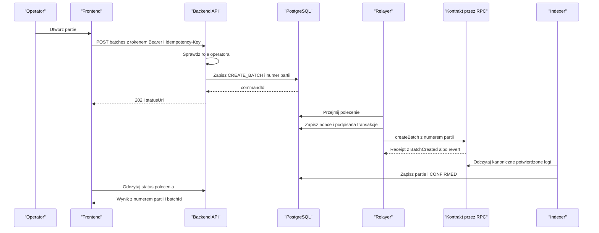
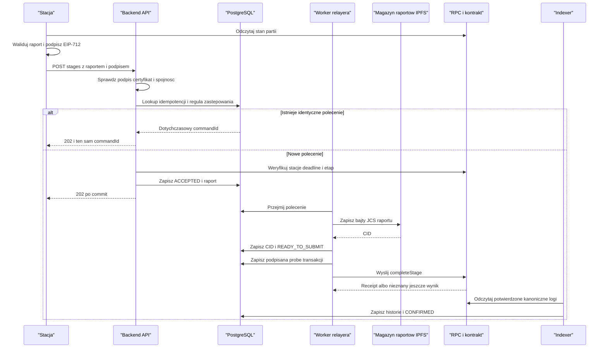
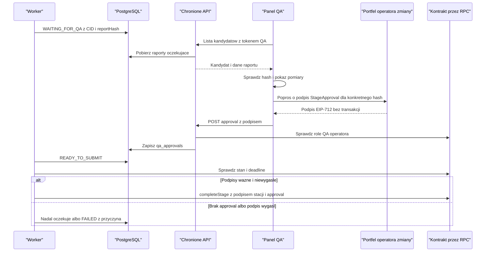
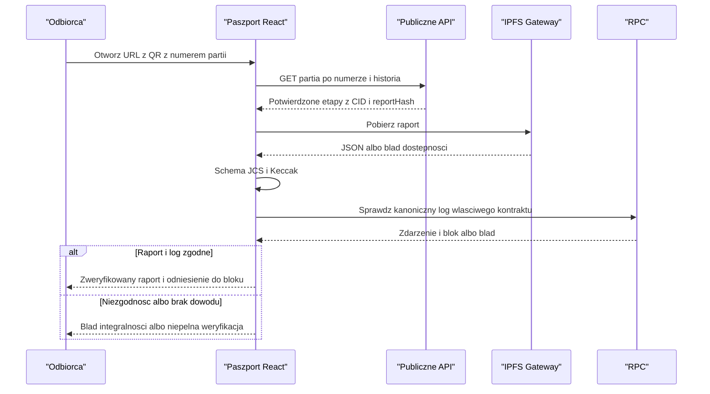

# Przepływy od kliknięcia do potwierdzenia

**Status:** projekt wykonania, zgodny z [protokołem](protocol.md) po zmianach [v2](changes-v2.md).
Szczegóły QA/auth z tego dokumentu trafiają do OpenAPI przed implementacją.
QA oznacza operatora zmiany uprawnionego do kontroli, nie dodatkową osobę.
Wymóg drugiego klucza i certyfikatu stacji pochodzi z PDF; techniczna realizacja
(podpis `StageApproval`, rejestr stacji on-chain) jest opisana w v2.
Strzałki sekwencji oznaczają wywołania i odpowiedzi, nie importy.
Dokładne warunki etapów ustala [production-rules](production-rules.md),
politykę approval [quality-approval](quality-approval.md), a role i sesje
[access-control](access-control.md). Wznowienie po błędzie: [corrections](corrections.md).

## 1. Przygotowanie środowiska

1. Uruchom PostgreSQL, Anvil i Kubo; sprawdź health, RPC chainId i dostępność bazy.
2. Wykonaj migracje. Wdróż kontrakt i zapisz adres, deployment block i ABI.
3. Admin nadaje role relayerowi, operatorom i operatorowi zmiany z QA oraz
   rejestruje stacje on-chain (`registerStation`: adres, stationId, `expiresAt`,
   `stageMask`); wystawia JSON certyfikatu zgodny z rejestrem (DEC-06/13).
4. Każdy moduł dostaje tę samą domenę, sieć, adres i uzgodnioną marszrutę.
5. Backend sprawdza dostęp do DB, zgodność sieci/kontraktu i zależności.
6. Frontend i symulator uruchamiają się dopiero po gotowości API.

Anvil po resecie to nowy stan: nie zostawiaj starej bazy/projekcji udającej
ciągłość. Użyj odizolowanego środowiska lub jawnego resetu i ponownej indeksacji.
Nie usuwaj wolumenów automatycznie.

## 2. Tworzenie partii

Autoryzacja: operator loguje się przez SIWE i dostaje token Bearer, a API sprawdza rolę.
Backend nadaje numer partii `B-RRRR-NNNN`; `batchId = keccak256(numer)`.
Relayer tworzy partię on-chain (`createBatch(string)`), więc kontrakt autoryzuje jego konto.
Audyt powiązania operatora z poleceniem pozostaje w backendzie.
Jeżeli ma być dowodzony także on-chain, potrzebny jest odrębny podpis operatora
i zmiana interfejsu; nie zapewnia tego sam `msg.sender` relayera.

<!-- mermaid-checked: every participant uses `participant Id as "Label"`, no \n in aliases/messages/notes, every alt/opt/loop closed by end, no `:` inside any alias -->

Polecenie CREATE_BATCH pomija pinowanie i QA. Przed potwierdzeniem partia
może być widoczna w prywatnym statusie, nie jako ukończone utworzenie
w publicznej projekcji. Ponowny Idempotency-Key z tą samą treścią wskazuje
ten sam commandId i numer partii; z inną treścią daje konflikt.

## 3. Zgłoszenie etapu bez ręcznej bramki QA

1. Symulator czeka na poprzedni etap i czyta stan partii (`getBatch`) z kontraktu.
2. Buduje raport, waliduje, kanonizuje, liczy hash i podpisuje StageCompletion
   (bez nonce, z deadline w oknie `maxDeadlineWindow`).
3. API sprawdza format, path/body, hash, podpis, aktywny certyfikat zgodny
   z adresem stacji i rejestrem on-chain (`expiresAt`, `stageMask`), deadline
   i reguły wstępne.
4. Identyczny wcześniejszy podpisany zamiar (ten sam digest) zwraca istniejące
   polecenie. Lookup następuje po weryfikacji dowodu stacji, lecz **przed**
   odrzuceniem za deadline lub zmieniony stan etapu. Inaczej retry po sukcesie
   mylnie dawałby konflikt.
5. Nowy zamiar przechodzi sprawdzenie bieżącego stanu, deadline i
   [reguły zastępowania](corrections.md) i jest zapisany atomowo wraz z idempotencją.
6. Worker pinując zapisuje CID, potem weryfikuje aktualny stan i deadline.
7. Jeden writer przygotowuje, podpisuje i zapisuje transakcję, potem ją wysyła.
8. Receipt sukcesu nie jest jeszcze potwierdzeniem projekcji.
9. Indexer po wymaganej liczbie bloków zapisuje historię i CONFIRMED atomowo
   z checkpointem. Frontend odświeża partię i historię.

Raport z `qaPassed=false` zgodny z profilem pomiarów przechodzi tę samą ścieżkę
(przyjęcie `202`, pinowanie), ale pomija bramkę QA. `completeStage` emituje
`StageRejected` bez zmiany stanu partii, a polecenie kończy `CONFIRMED` z
`outcome=REJECTED`. Niespójność `qaPassed` z profilem to `422` bez przyjęcia.

<!-- mermaid-checked: every participant uses `participant Id as "Label"`, no \n in aliases/messages/notes, every alt/opt/loop closed by end, no `:` inside any alias -->

Przy równoczesnym identycznym POST oba requesty mogą minąć lookup:
constraint DB rozstrzyga wyścig. Po naruszeniu unikalności odczytaj zwycięskie
polecenie i porównaj podpisywane pola; nie zwracaj ślepego sukcesu.
Uwierzytelnienie prywatnego GET statusu opisuje sekcja 7.

## 4. Dwa klucze przy zamknięciu kontroli - wariant wykonawczy

PDF wymaga podpisu maszyny/czujnika i operatora zmiany. Podpis stacji to EIP-712
`StageCompletion` pod raportem, a drugi podpis to EIP-712 `StageApproval` operatora
pod tym samym `reportHash`; oba trafiają do jednego wywołania `completeStage`.
Operator ma techniczną rolę QA_INSPECTOR_ROLE i nie wysyła transakcji ani nie
płaci gazu. To obowiązkowa bramka dla etapu kontroli, nie opcjonalny trzeci audyt.

Raport z `qaPassed=false` nie trafia do kolejki zatwierdzania i nie może zostać
zalegalizowany przez operatora (kontrakt zapisuje tylko `StageRejected`).
Jeśli pomiary są poprawne, a etap wymaga ręcznego QA:

1. Przyjmij i przypnij raport jak wyżej. Zapisz `WAITING_FOR_QA`, CID i hash.
2. Udostępnij kandydata tylko uprawnionej obsłudze/QA. Nie jest publiczną historią.
3. QA sprawdza tożsamość stacji, raport, jego hash i wybraną partię/etap.
4. Portfel podpisuje `StageApproval` (`eth_signTypedData_v4`), UI wysyła podpis
   `POST /api/v1/qa/candidates/{commandId}/approval`.
5. Backend odzyskuje adres z podpisu i sprawdza: zgodność z sesją, aktualną
   QA_INSPECTOR_ROLE (z łańcucha), adres różny od stacji, hash i niewygasły
   `approvalDeadline`. Zapisuje approval w `qa_approvals`.
6. Worker ponownie czyta stan i deadline, po czym przechodzi do READY_TO_SUBMIT.
7. `completeStage` weryfikuje oba podpisy sam; backend niczego nie „wymusza”
   cache'em. Odzyskany signer stacji i operator muszą być różnymi adresami;
   aktualne role obu (rejestracja stacji, QA) muszą pozwalać na zamknięcie kontroli.

<!-- mermaid-checked: every participant uses `participant Id as "Label"`, no \n in aliases/messages/notes, every alt/opt/loop closed by end, no `:` inside any alias -->

### API dla QA

| Metoda / ścieżka | Dostęp | Wynik |
|---|---|---|
| `GET /api/v1/qa/candidates` | aktualna rola QA | paginowana lista WAITING_FOR_QA, bez sekretów/signature |
| `GET /api/v1/qa/candidates/{commandId}` | QA lub właściciel polecenia | raport, CID, hash, partia/etap, deadline i aktualność |
| `POST /api/v1/qa/candidates/{commandId}/approval` | aktualna rola QA, sesja = adres z podpisu | zapis approval; `409` gdy inny operator ma ważne approval |

W MVP brak osobnej trwałej decyzji „odrzucono przez QA”: odmowa to brak podpisu,
polecenie czeka do wygaśnięcia i przechodzi w FAILED. Osobna decyzja odrzucenia
wymagałaby nowego typu EIP-712 i zdarzenia, nie cichej edycji kandydata.

## 5. Publiczny paszport i integralność

<!-- mermaid-checked: every participant uses `participant Id as "Label"`, no \n in aliases/messages/notes, every alt/opt/loop closed by end, no `:` inside any alias -->

Sprawdzenie on-chain obejmuje właściwą sieć/adres kontraktu, tx receipt
z sukcesem, logIndex, batchId, stageId, reportHash i kanoniczny blockHash,
przy tej samej polityce potwierdzeń co API. Nie wystarczy dowolny log z takim hash.
UI liczy `batchId = keccak256(numer partii)` samodzielnie i filtruje logi po
indeksowanym `batchId`. Historia pokazuje też odrzucenia (`StageRejected`) jako
osobne wpisy, odróżnione od ukończonych etapów.

UI rozróżnia:
- **Dane API:** odczytano projekcję; nie wykonano niezależnego sprawdzenia.
- **Integralność zgodna:** JSON zgadza się z hashem API, lecz brak niezależnego RPC.
- **Zweryfikowano on-chain:** porównano raport z kanonicznym zdarzeniem.
- **Błąd integralności:** hash/schemat niezgodny.
- **Nie można zweryfikować:** brak RPC/gateway; to nie jest potwierdzenie ani
  dowód fałszerstwa.

## 6. Awarie i decyzja o ponowieniu

| Punkt awarii | Co jest trwałe | Co robić |
|---|---|---|
| przed commit API | brak zaakceptowanego commandId | klient ponawia identyczny zamiar; idempotencja rozstrzyga nieznany wynik |
| po commit, przed odpowiedzią | polecenie | identyczny POST zwraca istniejący commandId |
| pinowanie timeout | raport i etap polecenia, CID może być jeszcze nieznany | sprawdź/ponów pinowanie tej samej treści z backoff; nie twórz nowego command |
| CID zapisany, proces padł | raport i CID | wznowienie nie musi ponownie pinować |
| tx zapisana, przed broadcast | nonce relayera i podpisane bajty/hash | wyślij te same bajty |
| timeout send / brak receipt | tx hash i nonce relayera | uzgadniaj transakcję; brak receipt nie oznacza FAILED; zablokowana tx = procedura ręczna (bez fee-bump w MVP) |
| receipt revert | znany skutek i zużyty nonce konta relayera | FAILED; stan partii się nie zmienił |
| deadline minął przed send | oryginalny podpis i polecenie | FAILED z `retryAllowedAfter`; nowy raport po warunku [reguły zastępowania](corrections.md) |
| brak approval | przypięty kandydat | WAITING_FOR_QA do podpisu operatora lub wygaśnięcia |
| reorg | surowe logi, checkpoint i potwierdzona wcześniej projekcja | ponowny skan okna N bloków, unieważnij skutki, odtwórz projekcję i statusy |

Retry ma limit i jawny nextRetryAt dla przejściowego kroku.
SUBMITTED o nieznanym wyniku wymaga alarmu/uzgodnienia, nie automatycznego
porzucenia tylko dlatego, że skończyły się próby odpytywania.
Wygaśnięcie podpisu po wysłaniu nie dowodzi revertu: transakcja mogła zostać
wykonana przed deadline. Najpierw sprawdź kanoniczny receipt.

## 7. Dostęp do prywatnego statusu

Challenge SIWE jest jednorazowy i związany z domeną oraz adresem.
Po weryfikacji backend wydaje losowy token Bearer z terminem ważności (w bazie
tylko jego skrót SHA-256). Stacja skryptowa używa tego samego protokołu,
podpisując challenge przez eth-account i wysyłając nagłówek `Authorization`.
Brak cookie i CSRF. Dokładna treść challenge i format tokenu trafiają do OpenAPI.

Ścieżki: `POST /api/v1/auth/challenges`,
`POST /api/v1/auth/sessions`, `DELETE /api/v1/auth/sessions/current`.
Nie są zaimplementowane. Nie traktuj losowego UUID commandId jako uprawnienia.
Tożsamość właściciela zgłoszenia stacji wynika z recover raportu, a nie
z niezweryfikowanego `owner` w JSON. Token użyty do prywatnego odczytu musi
odpowiadać temu adresowi lub mieć aktualną rolę administratora.
Sama rola QA daje dostęp do kandydatów, nie do wszystkich prywatnych commands.
Szczegóły opisuje [access-control](access-control.md).

## 8. Zasada spójności projekcji

Backend może odebrać receipt zanim indexer dojdzie do tego bloku.
Dlatego jedno miejsce (indexer) zatwierdza domenowy CONFIRMED i projekcję;
worker zapisuje receipt/próbę. Indexer identyfikuje efekt po logu, a nie
wyłącznie po ostatniej próbie polecenia: wcześniejsza próba mogła zostać wykonana.
Approval operatora nie jest zdarzeniem łańcucha; `qaOperator` pochodzi z `StageCompleted`.
