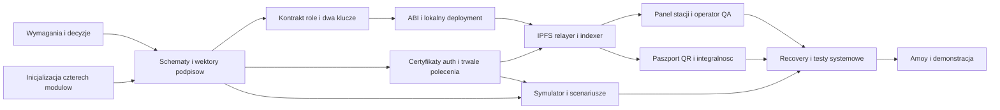

# Wstępny plan projektu - 12 tygodni

**Źródło nadrzędne:** [PDF i mapa zgodności](source-alignment.md).
**Wymagania:** [spec](spec.md), REQ-001..014.
**Status:** plan roboczy, nie lista ukończonych prac. Żadne zadanie wykonawcze
nie jest oznaczone jako zrobione, bo kod aplikacji jeszcze nie istnieje.

## 1. Cel i zasady wykonania

Dowieźć prototyp modelowej linii z podpisanymi zdarzeniami, certyfikatami stacji,
maszyną stanów/RBAC, kontrolą współzatwierdzaną kluczem operatora, raportami
IPFS oraz responsywnym panelem i publicznym paszportem.
Bez nowego sprzętu, Hyperledger Fabric, mikroserwisów, NFT i produkcyjnego PKI.
Backend oraz kontrakty mają działać razem najpóźniej w tygodniu 5.

### Kontekst techniczny i ograniczenia

Solidity/Foundry i Polygon, Java 21/Spring/Maven/Web3j, Python 3.11+,
React/TypeScript/Vite, PostgreSQL, IPFS/Pinata.
Dokładne wersje przypinamy podczas inicjalizacji. Jedna instancja relayera;
testy lokalne bez płatnych usług, końcowa demonstracja na Amoy.
Nie deklarujemy produkcyjnego SLA ani kosztu zero niezależnie od limitów usług.

Nie ma osobnej konstytucji projektu ani kodu do migracji. Zasady przyjmujemy
z PDF, [architektury](architecture.md) i [development](development.md):
minimalny stan on-chain, brak sekretów w Git, jawne błędy, wspólne schematy,
podpisy stacji i operatora oraz brak nadmiernej architektury.
Wytyczne migracyjne framework-to-framework nie dotyczą tego nowego szkieletu.

### Dokumenty wejściowe

- [Diagramy](diagrams.md): komunikacja i zależności buildów.
- [Przepływy](flows.md): API, worker, współzatwierdzenie, indexer i UI.
- [Model danych](data-model.md): lokalna trwałość, stany i minimalny on-chain.
- [Protokół](protocol.md): JSON, hash, EIP-712, statusy i retry.
- [Tożsamość stacji](station-identity.md): certyfikat i rejestr.
- [Decyzje](decisions.md): otwarte warianty i blokady.
- [Reguły produkcji](production-rules.md): wybrana ogólna marszruta i profile QA.
- [Poprawki](corrections.md): alternatywy recovery bez wskazania rozwiązania.
- [Dwa klucze](quality-approval.md): zakres i ograniczenia approval.
- [Uprawnienia](access-control.md): macierz, owner i proponowany login.

Przed zadaniem dotyczącym niezatwierdzonego formatu należy zamknąć odpowiednią
decyzję. Wymagań dwóch kluczy i certyfikatów nie można usunąć przez głosowanie
nad technologią. Brak decyzji jest blokadą zadania, nie zgodą na cichy default.
Aktualizacja 2026-10-27: zakres ogólnych etapów DEC-01 wybrano z użytkownikiem;
DEC-09 pozostawiono otwartą na jego życzenie. T026 nadal jest przyszłym zadaniem,
nie zgodą na automatyczny wybór unieważniania nonce. Profile i szczegóły
DEC-02..06/13 pozostają do zatwierdzenia po przeczytaniu pięciu opisów.

## 2. Harmonogram i punkty odbioru

| Tydzień | Wspólny wynik | Osoba 1 - kontrakt | Osoba 2 - backend | Osoba 3 - frontend | Osoba 4 - symulator/testy |
|---|---|---|---|---|---|
| 1 | zamknięty zakres i decyzje blokujące | etapy, role, dwa klucze | API, idempotencja, DB | makiety stacji/paszportu/QA | scenariusze, certyfikat, jednostki |
| 2 | szkielety, schema i wspólny wektor | EIP-712/testy | hash/podpis, migracje | router, layout, stany | modele, hash/podpis |
| 3 | reguły i przyjęcie polecenia | maszyna stanów i approval | auth, certyfikaty, trwałe 202 | UI na fixture'ach | tożsamość i klient API |
| 4 | backend + kontrakt lokalnie | deployment, ABI | IPFS, relayer i nonce | podłączenie odczytów | pierwszy pełny scenariusz |
| 5 | lokalny pionowy MVP | poprawki integracyjne | indexer, receipt/projekcja | tworzenie/status partii | test jednej partii i QA fail |
| 6 | pełna kontrola dwóch kluczy | wymuszenie niezależności | kolejka WAITING_FOR_QA | portfel operatora i approval | scenariusze brakujących podpisów |
| 7 | publiczny paszport | stabilne eventy | historia i paginacja | QR, integralność, mobile | scenariusze pozytywne/negatywne |
| 8 | odporność na restart | ewentualne poprawki reguł | retry/recovery i reorg | prezentacja awarii/statusów | awarie i konkurencja |
| 9 | odbiór lokalny | fuzz/role/replay | migracje i auth tests | UI/E2E/accessibility | pełna macierz integracyjna |
| 10 | Amoy i prawdziwa Pinata | wdrożenie/weryfikacja | konfiguracja i gaz | sieć testowa/explorer | próba demonstracji |
| 11 | bufor poprawek | usuwanie błędów | usuwanie błędów | UX/mobile | regresja i raport |
| 12 | demonstracja i dokumentacja | opis kontraktu | instrukcja uruchomienia | instrukcja użytkownika | spójny scenariusz, wyniki i ograniczenia |

Tydzień 5 to działający przepływ minimalny, nie pełna gotowość UI.
Obsługa reguł dwóch kluczy istnieje w kontrakcie wcześniej; tydzień 6 spina
ją z wygodnym panelem operatora. Nie demonstruj kontroli bez drugiego klucza
jako ukończonego wymagania.

## 3. Kroki i zadania

Ścieżki są względem katalogu projektu. Każdy autor dodaje testy swojego kodu;
osoba 4 koordynuje
testy integracyjne. Dokładne prerequisites są w sekcji 4.

### P1.1 - Zakres, schematy i narzędzia

**Wymagania:** REQ-001, REQ-003, REQ-011, REQ-013, REQ-014.
**Wejścia:** PDF, decisions, protocol, station-identity.
**Odbiór:** wybrana marszruta, jednostki, wariant dwóch podpisów i certyfikatu;
odtwarzalne narzędzia i zgodne formaty.

- [ ] T001 [Plan:1.1] Cały zespół: zatwierdzić blokujące DEC-01..06/13 w `docs/decisions.md`; dopisać parametry QA i kryteria odbioru w `docs/spec.md`.
- [ ] T002 [Plan:1.1] Osoby 2+4 z osobą 1: utworzyć `shared/schemas/openapi.yaml`, `telemetry.schema.json`, `eip712.json`, `station-certificate.schema.json` i zgodne przykłady w `shared/fixtures/`.
- [ ] T003 [Plan:1.1] Osoba 1: utworzyć `contracts/foundry.toml`, przypiąć OpenZeppelin i forge-std oraz potwierdzić kompilację i discovery testów.
- [ ] T004 [Plan:1.1] Osoba 2: utworzyć `backend/pom.xml`, Maven Wrapper i `backend/src/main/java/pl/pz/supplyblockchain/SupplyBlockchainApplication.java`; sprawdzić start aplikacji.
- [ ] T005 [Plan:1.1] Osoba 3: utworzyć `frontend/package.json`, lockfile, Vite/TS/ESLint, `frontend/src/app/providers.tsx` i `router.tsx`; build ma obejmować type-check.
- [ ] T006 [Plan:1.1] Osoba 4: utworzyć `simulator/pyproject.toml`, pakiet i CLI w `simulator/src/supply_chain_simulator/cli.py`; dodać pytest i instalację w venv.
- [ ] T007 [Plan:1.1] Osoby 2+4: utworzyć `infrastructure/local/compose.yaml` i `.env.example`, sprawdzenie health DB/RPC; opisać świadomy reset w istniejącym README.

### P2.1 - Tożsamość i podpisy

**Wymagania:** REQ-003, REQ-004, REQ-012, REQ-013, REQ-014.
**Wejścia:** schematy, protocol, station-identity, DEC-03/05/13.
**Odbiór:** wspólny reportHash i signer w Python/Java/Solidity;
certyfikat nie zastępuje roli; prywatny GET nie działa bez uprawnienia.

- [ ] T008 [Plan:2.1] Osoby 1+2+4: wygenerować i zweryfikować `shared/fixtures/signature-vector.json`; dodać testy JCS/Keccak/EIP-712 w `contracts/test/`, `backend/src/test/java/pl/pz/supplyblockchain/` i `simulator/tests/`.
- [ ] T009 [Plan:2.1] Osoba 4: zaimplementować `simulator/src/supply_chain_simulator/identity.py`, `models.py`, `telemetry.py` i `signing.py`; osobny klucz/certyfikat każdej stacji.
- [ ] T010 [Plan:2.1] Osoba 2: zaimplementować rejestr/weryfikator certyfikatów w `backend/src/main/java/pl/pz/supplyblockchain/infrastructure/persistence/` oraz migrację w `backend/src/main/resources/db/migration/`.
- [ ] T011 [Plan:2.1] Osoba 2 z osobami 3+4: zaimplementować uzgodniony challenge/session w `backend/src/main/java/pl/pz/supplyblockchain/api/` i `config/`; testować expiry, replay, owner, role, logout i CSRF zgodnie z transportem sesji.

### P3.1 - US1/US2: kontrakt i trwałe przyjęcie

**Wymagania:** REQ-001, REQ-002, REQ-004, REQ-005, REQ-006, REQ-014.
**Wejścia:** zatwierdzone etapy i role, data-model, flows.
**Odbiór:** testy przejść i dwóch kluczy, brak pełnego JSON on-chain,
idempotentny zapis CREATE_BATCH/STAGE i status po uwierzytelnieniu.

- [ ] T012 [US1] [Plan:3.1] Osoba 1: utworzyć `contracts/src/SupplyChain.sol` i `contracts/test/SupplyChain.t.sol`: role, createBatch, etapy, nonce, EIP-712, approval z adresem operatora, niezależność kluczy i minimalne eventy.
- [ ] T013 [US1] [Plan:3.1] Osoba 1: utworzyć `contracts/script/DeploySupplyChain.s.sol`, `ConfigureRoles.s.sol`, wyeksportować `shared/abi/SupplyChain.abi.json` i publiczne dane lokalnego wdrożenia.
- [ ] T014 [US2] [Plan:3.1] Osoba 2: utworzyć domenę i trwałe repozytoria commands/attempts/projections w `backend/src/main/java/pl/pz/supplyblockchain/domain/` i `infrastructure/persistence/`; dodać constraints, lease i indeksy w migracjach.
- [ ] T015 [US2] [Plan:3.1] Osoba 2: zaimplementować przyjęcie partii/etapu, idempotencję, Problem Details i status w `backend/src/main/java/pl/pz/supplyblockchain/application/` i `api/`; `202` dopiero po commit.

### P4.1 - US2/US5: IPFS, relayer i projekcja

**Wymagania:** REQ-006, REQ-007, REQ-008, REQ-011, REQ-012.
**Wejścia:** ABI, data-model, flow awarii, DEC-07..11.
**Odbiór:** w tygodniu 5 jedna lokalna partia i poprawny etap przechodzą
od API przez raport/kontrakt do potwierdzonej projekcji; restart nie gubi zadania.

- [ ] T016 [US2] [Plan:4.1] Osoba 2: zaimplementować `backend/src/main/java/pl/pz/supplyblockchain/infrastructure/ipfs/PinataReportStorage.java` z timeoutem, walidacją CID i testami błędów.
- [ ] T017 [US2] [Plan:4.1] Osoba 2: skonfigurować generowanie wrappera Web3j w `backend/pom.xml`; zaimplementować `backend/src/main/java/pl/pz/supplyblockchain/infrastructure/blockchain/RelayerTransactionSender.java`: jeden writer, trwałe signed tx i uzgadnianie hash.
- [ ] T018 [US2] [Plan:4.1] Osoba 2: zaimplementować `backend/src/main/java/pl/pz/supplyblockchain/infrastructure/queue/RelayerWorker.java`: przejęcie, pinowanie, WAITING_FOR_QA, preflight, send/recovery i kontrolowany retry.
- [ ] T019 [US5] [Plan:4.1] Osoba 2: zaimplementować `backend/src/main/java/pl/pz/supplyblockchain/infrastructure/blockchain/ChainEventIndexer.java`: logi, potwierdzenia, projekcje i checkpoint w jednej transakcji, reorg.
- [ ] T020 [US2] [Plan:4.1] Osoba 4: utworzyć `simulator/src/supply_chain_simulator/client.py`, `runner.py` i scenariusze w `simulator/scenarios/`; czytać nonce z kontraktu i czekać na potwierdzenie.

### P5.1 - US3: panel stacji i dwa klucze kontroli

**Wymagania:** REQ-005, REQ-009, REQ-014.
**Wejścia:** kolejka kandydatów z flows, ABI approval, autoryzacja sesji.
**Odbiór:** operator ręcznie wpisuje/skanuje ID, przegląda raport stacji
i zatwierdza kontrolę swoim niezależnym kluczem; brak dowodu blokuje przejście.

- [ ] T021 [US3] [Plan:5.1] Osoba 2: dodać chronioną listę/szczegóły kandydatów w `backend/src/main/java/pl/pz/supplyblockchain/api/` i uzgodnione OpenAPI; zwracać CID/hash/deadline bez prywatnych podpisów.
- [ ] T022 [US3] [Plan:5.1] Osoba 3: zaimplementować `frontend/src/lib/api/client.ts`, hooks w `frontend/src/features/batches/` i ekran w `frontend/src/features/operator/`; tworzenie/status, ręczne ID i responsywność.
- [ ] T023 [US3] [Plan:5.1] Osoba 3: zaimplementować `frontend/src/features/qa/QaPage.tsx`, approval hook i `frontend/src/lib/blockchain/contract.ts`; sprawdzać sieć, raport, różne adresy, odrzucenie portfela, revert i potwierdzenia.

### P6.1 - US4: publiczny paszport

**Wymagania:** REQ-003, REQ-007, REQ-008, REQ-010.
**Wejścia:** publiczne DTO, kanoniczna historia, fixture'y i diagram odczytu.
**Odbiór:** bez portfela można otworzyć QR, przeczytać historię i odróżnić
zgodny raport, niezgodność oraz brak możliwości weryfikacji.

- [ ] T024 [US4] [Plan:6.1] Osoba 2: udostępnić paginowaną historię i projekcję w `backend/src/main/java/pl/pz/supplyblockchain/api/`, bez wewnętrznych danych commands/certyfikatów.
- [ ] T025 [US4] [Plan:6.1] Osoba 3: zaimplementować `frontend/src/features/passport/PassportPage.tsx`, `reportIntegrity.ts`, `frontend/src/components/timeline/` i `qr/`; testować QR, mobile, JCS/hash i zgodność z kanonicznym logiem.

### P7.1 - US5: odporność i odbiór lokalny

**Wymagania:** REQ-004, REQ-005, REQ-006, REQ-008, REQ-011, REQ-012, REQ-013, REQ-014.
**Wejścia:** testing, DEC-09 i cała ścieżka lokalna.
**Blokada:** mechanizm nowej autoryzacji po trwałym błędzie nie jest wybrany.
Testy restartu tej samej operacji można pisać niezależnie; T026 i pełny odbiór
recovery wymagają późniejszej decyzji użytkownika/zespołu.
**Odbiór:** macierz testów przechodzi, recovery jest jawne, a brak usługi
lub dowodu nie staje się pozornym sukcesem.

- [ ] T026 [US5] [Plan:7.1] Osoby 1+2+4: rozstrzygnąć DEC-09 i zaimplementować wybraną procedurę recovery w `contracts/src/SupplyChain.sol`, backend application i CLI symulatora; nie usuwać starej idempotencji ani nie zmieniać podpisu w miejscu.
- [ ] T027 [US5] [Plan:7.1] Osoba 4 z autorami modułów: dodać testy restartu, konkurencji, reorg, certyfikatów i dwóch podpisów w `backend/src/test/`, `contracts/test/`, `simulator/tests/`, `frontend/tests/`; odnotować wyniki w `docs/testing.md`.

### P8.1 - Testnet i przekazanie projektu

**Wymagania:** REQ-001, REQ-007, REQ-009, REQ-010, REQ-011, REQ-012.
**Wejścia:** odbiór lokalny i stabilne ABI/schematy.
**Odbiór:** 12-tygodniowy cel PDF: odtwarzalne demo, źródła i instrukcja,
bez sekretów w repozytorium i bez deklaracji niezaimplementowanych możliwości.

- [ ] T028 [Plan:8.1] Cały zespół: utworzyć działające workflow w `.github/workflows/` repozytorium projektu zgodnie z `infrastructure/ci/README.md`; testy PR bez publicznego RPC/Pinaty.
- [ ] T029 [Plan:8.1] Osoby 1+2+3: wdrożyć sprawdzony kontrakt na Amoy, zapisać `shared/deployments/amoy.json`, skonfigurować Pinatę/RPC i frontend; żadnych kluczy/JWT w plikach publicznych.
- [ ] T030 [Plan:8.1] Osoba 4 z całym zespołem: dopisać instrukcję demonstracji i rzeczywiste wyniki do `docs/testing.md` oraz aktualne uruchomienie do `docs/development.md`; odebrać wszystkie REQ-001..014.

## 4. Zależności i praca równoległa

Lista wierszy to **bezpośrednie prerequisites**; zależności przechodnie wynikają
z nich. Zadania bez wspólnych plików i bez wzajemnych prerequisites można
prowadzić równolegle. To nie znaczy, że 4 osoby zrobią 4 backendowe zadania naraz.

| Zadanie | Wymaga ukończenia | Ważna blokada |
|---|---|---|
| T001 | brak | decyzje zespołu |
| T002 | T001 | schemat i format certyfikatu |
| T003, T004, T005, T006, T007 | brak | setup może trwać podczas ustaleń; nie zamraża protokołu |
| T008 | T002, T003, T004, T006 | zgodność kryptografii |
| T009 | T008 | identity i model Python |
| T010 | T002, T004, T007 | rejestr certyfikatów |
| T011 | T001, T004 | wybór auth i transportu sesji |
| T012 | T003, T008 | reguły kontroli i dwa klucze |
| T013 | T012 | rzeczywiste ABI |
| T014 | T002, T004, T007 | model trwałych danych |
| T015 | T008, T010, T011, T014 | bezpieczne trwałe przyjęcie |
| T016 | T002, T004 | port IPFS; można pracować na stubach |
| T017 | T013, T014 | Web3j i nonce |
| T018 | T015, T016, T017 | worker, QA i replay |
| T019 | T013, T014, T017 | indeksowanie niezależne od UI |
| T020 | T009, T013, T015 | RPC nonce i klient |
| T021 | T011, T015, T018 | nieudostępnianie kandydatów publicznie |
| T022 | T005, T011, T015 | UI może wcześniej używać fixture'ów T002 |
| T023 | T013, T019, T021, T022 | operator zatwierdza ten sam hash |
| T024 | T019 | historia z kanonicznych logów |
| T025 | T005, T008, T024 | poprawne poziomy weryfikacji |
| T026 | T018, T019, T020 | DEC-09; nie odwlekać do testnet |
| T027 | T020, T023, T025, T026 | pełna ścieżka i recovery |
| T028 | T003, T004, T005, T006, T007 | można dodawać joby wcześnie; pełna integracja po T027 |
| T029 | T027, T028 | lokalny odbiór przed Amoy |
| T030 | T029 | końcowe wyniki, nie sama lista planowanych testów |

### Diagram pakietów prac

Diagram agreguje zadania dla czytelności; tabela powyżej rozstrzyga szczegóły.

<!-- mermaid-checked: no \n, no em-dash/en-dash, no {} in labels, subgraphs are id["label"], arrows are -->|"label"|, all subgraphs closed by end, ids unique -->

## 5. Requirement Mapping

Dowody to **planowane** pliki i zachowania, nie potwierdzenie ukończenia.

| REQ ID | Opis | Plan Items | Implementation Evidence |
|---|---|---|---|
| REQ-001 | środowisko i role | P1.1, P3.1, P8.1 | Foundry/Compose, skrypty ról, deployment |
| REQ-002 | idempotentne utworzenie partii | P3.1 | SupplyChain, create use case i API |
| REQ-003 | spójne raporty i skróty | P1.1, P2.1, P6.1 | schema, wektor, modele i reportIntegrity |
| REQ-004 | podpis i ochrona przed replay | P2.1, P3.1, P7.1 | signing, verifier, SupplyChain i testy mutacji |
| REQ-005 | kolejność i pozytywna kontrola | P3.1, P5.1, P7.1 | maszyna stanów, approval i QA page |
| REQ-006 | trwałość i nonce | P3.1, P4.1, P7.1 | migracje, worker, transaction sender |
| REQ-007 | IPFS i integralność | P4.1, P6.1, P8.1 | PinataReportStorage, CID/hash, paszport |
| REQ-008 | kanoniczna historia | P4.1, P6.1, P7.1 | indexer, checkpoint, historia i reorg tests |
| REQ-009 | UI stacji i operatora | P5.1, P8.1 | operator page, QA page i stany polecenia |
| REQ-010 | publiczny paszport/QR | P6.1, P8.1 | PassportPage, timeline, QR i mobile tests |
| REQ-011 | symulator i scenariusze | P1.1, P4.1, P7.1, P8.1 | CLI, runner, scenarios, testy systemowe |
| REQ-012 | auth, awarie i diagnoza | P2.1, P4.1, P7.1, P8.1 | session, retry/recovery, logi i instrukcja |
| REQ-013 | certyfikat każdej stacji | P1.1, P2.1, P7.1 | identity, certificate registry, odwołanie |
| REQ-014 | dwa niezależne klucze kontroli | P1.1, P2.1, P3.1, P5.1, P7.1 | podpis stacji, approval operatora, test niezależności |

## 6. Ryzyka i reguły cięcia zakresu

- **Za dużo prac backendowych:** osoba 4 pomaga w stubach/testach i dokumentacji,
  ale nie równoległym przepisywaniu tych samych adapterów. Najpierw jeden pion.
- **Kryptografia między językami:** wektor przed API/workerem; brak zgodności
  zatrzymuje integrację zamiast generować kilka różnych protokołów.
- **Dwa podpisy i deadline:** szybki scenariusz demonstracyjny i jawny czas
  oczekiwania; expiry nie może uruchamiać podmiany starego podpisu.
- **Awaria darmowego RPC/Pinaty/faucet:** testy PR na stubach/Anvil,
  konfiguracja i próba publicznego demo przed tygodniem 12.
- **Presja czasu:** usuń PWA, rozbudowane dashboardy i dodatkowe integracje,
  nie wymagania PDF: QA, oba klucze, certyfikat, QR, publiczna historia i IPFS.

## 7. Walidacja i przekazanie

Macierz i konkretne scenariusze są w [testing](testing.md). Lokalne integracje
korzystają z PostgreSQL, Anvil i kontrolowanych odpowiedzi HTTP; nie zastępuj
PostgreSQL przez H2 jako dowodu działania blokad. UI testuj komponentowo
i na responsywnych ekranach. Brak Dockera/przeglądarki oznacza jawny brak
pokrycia, nie test zaliczony przez fallback bez równoważnych zachowań.
Po każdym punkcie odbioru zapisz wyniki; finalnie sprawdź wszystkie 14 wymagań
z demonstracją źródła raportu, dwóch kluczy i publicznej integralności.
