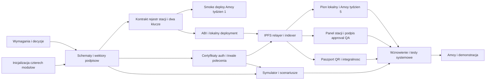

# Wstępny plan projektu - 12 tygodni

**Źródło nadrzędne:** [PDF i mapa zgodności](source-alignment.md).
**Wymagania:** [spec](spec.md), REQ-001..014.
**Zmiany v2 (2026-10-27):** [changes-v2](changes-v2.md) - wiążące, gdy starszy
tekst mówi inaczej. **Podział zadań:** [team-split](team-split.md) (zastępuje
kolumny „Osoba” poniżej). **Tydzień 1:** [week1-plan](weekly_plans/week1/week1-plan.md).
**Status:** plan roboczy, nie lista ukończonych prac. Żadne zadanie wykonawcze
nie jest oznaczone jako zrobione, bo kod aplikacji jeszcze nie istnieje.

## 1. Cel i zasady wykonania

Dowieźć prototyp modelowej linii z podpisanymi zdarzeniami, certyfikatami stacji,
maszyną stanów/RBAC, kontrolą współzatwierdzaną kluczem operatora, raportami
IPFS oraz responsywnym panelem i publicznym paszportem.
Bez nowego sprzętu, Hyperledger Fabric, mikroserwisów, NFT i produkcyjnego PKI.
Backend oraz kontrakty mają działać razem najpóźniej w tygodniu 5.

### Kontekst techniczny i ograniczenia

Solidity/Foundry i Polygon, Java 21/Spring (aktualna wspierana wersja)/Maven/Web3j,
Python 3.11+, React/TypeScript/Vite, PostgreSQL, IPFS (Kubo lokalnie, Pinata w demo).
Dokładne wersje przypinamy podczas inicjalizacji. Jedna instancja relayera;
testy lokalne bez płatnych usług, smoke deploy na Amoy w tygodniu 1,
integracja pionowa na Amoy w tygodniu 5, próba demo w tygodniu 10.
Nie deklarujemy produkcyjnego SLA ani kosztu zero niezależnie od limitów usług.

Nie ma osobnej konstytucji projektu ani kodu do migracji. Zasady przyjmujemy
z PDF, [architektury](architecture.md) i [development](development.md):
minimalny stan on-chain, brak sekretów w Git, jawne błędy, wspólne schematy,
podpisy stacji i operatora oraz brak nadmiernej architektury.
Wytyczne migracyjne framework-to-framework nie dotyczą tego nowego szkieletu.

### Dokumenty wejściowe

- [Diagramy](diagrams.md): komunikacja i zależności buildów.
- [Przepływy](flows.md): API, worker, współzatwierdzenie, indexer i UI.
- [Model danych](data-model.md): lokalna trwałość, stany i minimalny on-chain.
- [Protokół](protocol.md): JSON, hash, EIP-712, statusy i retry.
- [Tożsamość stacji](station-identity.md): certyfikat i rejestr.
- [Decyzje](decisions.md): rejestr decyzji po zmianach v2.
- [Reguły produkcji](production-rules.md): wybrana ogólna marszruta i profile QA.
- [Poprawki](corrections.md): reguła zastępowania raportu (DEC-09 zamknięta).
- [Dwa klucze](quality-approval.md): podpisy stacji i operatora, warunki kontraktu.
- [Uprawnienia](access-control.md): macierz, owner i login (SIWE -> token Bearer).
- [Zmiany v2](changes-v2.md), [podział zadań](team-split.md), [tydzień 1](weekly_plans/week1/week1-plan.md).

Przed zadaniem dotyczącym niezatwierdzonego formatu należy sprawdzić odpowiednią
decyzję. Wymagań dwóch kluczy i certyfikatów nie można usunąć przez głosowanie
nad technologią. Brak decyzji jest blokadą zadania, nie zgodą na cichy default.
Aktualizacja 2026-10-27: DEC-03..06, 08..10, 12..16 ustalone z użytkownikiem
(zmiany v2); DEC-09 zamknięta jako wariant C uproszczony. Do potwierdzenia przez
zespół w tygodniu 1: DEC-02 (profile pomiarów), DEC-07 i DEC-11 (wartości
czasu i potwierdzeń). T026 jest zadaniem wykonawczym bez blokady decyzyjnej.

## 2. Harmonogram i punkty odbioru

Kolumny „Osoba” wynikają z [team-split](team-split.md). Szczegóły tygodnia 1:
[week1-plan](weekly_plans/week1/week1-plan.md).

| Tydzień | Wspólny wynik | Osoba 1 - kontrakt, indexer, CI | Osoba 2 - backend | Osoba 3 - schematy/Java/infra (tyg. 1), potem frontend | Osoba 4 - symulator/testy/dokumentacja |
|---|---|---|---|---|---|
| 1 | decyzje v2 potwierdzone, **bez frontendu**, wektor podpisu w Py/Java/Sol, smoke Amoy | T003, T012 (rdzeń), T031 | T004, T033 (Web3j), `POST stages` (202), start T011 | T002 (OpenAPI, schematy), T033 (krypto Javy), T007 (Compose), spike IPFS | T006, T008, profile i certyfikat, szkielet CI |
| 2 | schematy, OpenAPI, zamrożone profile, start frontendu | T012 (maszyna stanów, rejestr stacji), T028 (CI) | T011, migracje | T005, T032 (HTTPS, QR), TS: wektor, router, layout, mocki z OpenAPI | T009 (modele, podpis), certyfikat |
| 3 | kontrakt + przyjęcie polecenia | T012 (approval), T013 (deploy/ABI), T010 | T014, T015 (reguła zastępowania), T011 | UI na fixture'ach | tożsamość, klient API |
| 4 | backend + kontrakt lokalnie | T019 (indexer, start) | T016, T017 | podłączenie odczytów | T020 (pierwszy pełny scenariusz) |
| 5 | **lokalny pionowy MVP + powtórka na Amoy** | T019, T029 (Amoy) | T018, T021 (start) | T022 | test jednej partii i QA fail |
| 6 | pełna kontrola dwóch kluczy | T024 (historia) | T021, T026 (start) | T023 (podpis approval) | scenariusze brakujących podpisów |
| 7 | publiczny paszport i wznowienie | T024 | T026 | T025 (QR, integralność) | T027 (start) |
| 8 | odporność na restart | poprawki reguł, reorg testy | retry i odzysk | prezentacja awarii/statusów | awarie i konkurencja |
| 9 | odbiór lokalny | fuzz/role/deadline | migracje i auth tests | UI/E2E/accessibility | pełna macierz integracyjna |
| 10 | próba demo na Amoy z Pinatą | wdrożenie/weryfikacja | konfiguracja i gaz | sieć testowa/explorer | próba demonstracji |
| 11 | bufor poprawek | usuwanie błędów | usuwanie błędów | UX/mobile | regresja i raport |
| 12 | demonstracja i dokumentacja | opis kontraktu | instrukcja uruchomienia | instrukcja użytkownika | spójny scenariusz, wyniki i ograniczenia |

Tydzień 5 to działający przepływ minimalny, nie pełna gotowość UI.
Obsługa reguł dwóch kluczy istnieje w kontrakcie wcześniej; tydzień 6 spina
ją z wygodnym panelem operatora. Nie demonstruj kontroli bez drugiego klucza
jako ukończonego wymagania.

## 3. Kroki i zadania

Ścieżki są względem katalogu projektu. Każdy autor dodaje testy swojego kodu;
osoba 4 koordynuje testy integracyjne. Odpowiedzialni i recenzenci zadań:
[team-split](team-split.md) (obowiązuje zamiast numerów osób w opisach poniżej,
jeśli się różnią). Dokładne prerequisites są w sekcji 4.

### P1.1 - Zakres, schematy i narzędzia

**Wymagania:** REQ-001, REQ-003, REQ-011, REQ-013, REQ-014.
**Wejścia:** PDF, decisions, protocol, station-identity, changes-v2.
**Odbiór:** potwierdzone decyzje v2, jednostki, wariant dwóch podpisów i certyfikatu;
odtwarzalne narzędzia i zgodne formaty; smoke deploy na Amoy.

- [ ] T001 [Plan:1.1] Cały zespół: potwierdzić zmiany v2 i DEC-02/07/11 w `docs/decisions.md` (data, inicjały); dopisać parametry QA i kryteria odbioru w `docs/spec.md`.
- [ ] T002 [Plan:1.1] Osoba 3 (OpenAPI, telemetria, `eip712.json`) i osoba 4 (certyfikat) z recenzją osób 2 i 1: utworzyć `shared/schemas/openapi.yaml`, `telemetry.schema.json`, `eip712.json` (typy `StageCompletion` i `StageApproval`), `station-certificate.schema.json` i zgodne przykłady w `shared/fixtures/`.
- [ ] T003 [Plan:1.1] Osoba 1: utworzyć `contracts/foundry.toml` z jawnym `evm_version`, przypiąć OpenZeppelin i forge-std oraz potwierdzić kompilację i discovery testów.
- [ ] T004 [Plan:1.1] Osoba 2: utworzyć `backend/pom.xml` (aktualna wspierana wersja Spring Boot), Maven Wrapper i `backend/src/main/java/pl/pz/supplyblockchain/SupplyBlockchainApplication.java`; sprawdzić start aplikacji i zgodność Web3j z Jackson.
- [ ] T005 [Plan:2.1] Osoba 3 (**tydzień 2**, frontend poza tygodniem 1): utworzyć `frontend/package.json`, lockfile, Vite/TS/ESLint, `frontend/src/app/providers.tsx` i `router.tsx`; build ma obejmować type-check; lokalny HTTPS.
- [ ] T006 [Plan:1.1] Osoba 4: utworzyć `simulator/pyproject.toml`, pakiet i CLI w `simulator/src/supply_chain_simulator/cli.py`; dodać pytest i instalację w venv (Python 3.11-3.12).
- [ ] T007 [Plan:1.1] Osoba 3 z recenzją osób 2 i 4: utworzyć `infrastructure/local/compose.yaml` (PostgreSQL, Anvil, Kubo) i `.env.example`, sprawdzenie health DB/RPC/IPFS; opisać świadomy reset w istniejącym README.
- [ ] T031 [Plan:1.1] Osoba 1: smoke deploy kontraktu na Amoy (faucet, RPC, minimalny tip, `evm_version`, limity `eth_getLogs`); notatka z wynikami w `docs/development.md`.
- [ ] T032 [Plan:2.1] Osoba 3 (**tydzień 2**): spike HTTPS i skanera QR na telefonie; wybór biblioteki; decyzja w `frontend/README.md`.
- [ ] T033 [Plan:1.1] Osoba 3 (krypto): moduł Javy z JCS, Keccak i ręcznym odzyskiem EIP-712 (`StageCompletion`, `StageApproval`) na wektorze; osoba 2 (Web3j): kodowanie wywołania, podpis transakcji i opłaty EIP-1559 na Anvil (bez `.send()`).

### P2.1 - Tożsamość i podpisy

**Wymagania:** REQ-003, REQ-004, REQ-012, REQ-013, REQ-014.
**Wejścia:** schematy, protocol, station-identity, DEC-03/05/13.
**Odbiór:** wspólny reportHash i signer w Python/Java/TS/Solidity;
certyfikat zgodny z rejestrem on-chain; prywatny GET nie działa bez tokenu.

- [ ] T008 [Plan:2.1] Osoba 4 generuje, osoby 1+2+3 weryfikują `shared/fixtures/signature-vector.json` (raport, JCS, hash, digesty i podpisy `StageCompletion`/`StageApproval`, certyfikat); testy w `contracts/test/`, `backend/src/test/java/pl/pz/supplyblockchain/` i `simulator/tests/` w tygodniu 1, w `frontend/tests/` w tygodniu 2. Start we wtorek tyg. 1.
- [ ] T009 [Plan:2.1] Osoba 4: zaimplementować `simulator/src/supply_chain_simulator/identity.py`, `models.py`, `telemetry.py` i `signing.py`; osobny klucz/certyfikat każdej stacji; CLI wystawiania certyfikatów.
- [ ] T010 [Plan:2.1] Osoba 1: zaimplementować weryfikator certyfikatu i sprawdzanie zgodności z rejestrem on-chain w `backend/src/main/java/pl/pz/supplyblockchain/infrastructure/blockchain/` oraz rejestr w `infrastructure/persistence/` z migracją w `backend/src/main/resources/db/migration/` (przegląd: osoba 2).
- [ ] T011 [Plan:2.1] Osoba 2 z osobami 3+4: zaimplementować SIWE challenge i token Bearer (skrót SHA-256 w bazie) w `backend/src/main/java/pl/pz/supplyblockchain/api/` i `config/`; testować expiry, replay challenge, owner, role, logout i CORS.

### P3.1 - US1/US2: kontrakt i trwałe przyjęcie

**Wymagania:** REQ-001, REQ-002, REQ-004, REQ-005, REQ-006, REQ-014.
**Wejścia:** zatwierdzone etapy i role, data-model, flows.
**Odbiór:** testy przejść i dwóch kluczy, brak pełnego JSON on-chain,
idempotentny zapis CREATE_BATCH/STAGE z regułą zastępowania i status po uwierzytelnieniu.

- [ ] T012 [US1] [Plan:3.1] Osoba 1: utworzyć `contracts/src/SupplyChain.sol` i `contracts/test/SupplyChain.t.sol`: role, rejestr stacji (`registerStation`/`revokeStation`, `expiresAt`, `stageMask`), `createBatch(string)`, etapy 0..3, `completeStage` z podpisem stacji i `StageApproval` operatora (różne adresy, aktualna rola QA), `StageRejected`, deadline i `maxDeadlineWindow`, minimalne eventy z indeksowanym `batchId`. Bez nonce i bez `approveStage` ([changes-v2](changes-v2.md)).
- [ ] T013 [US1] [Plan:3.1] Osoba 1: utworzyć `contracts/script/DeploySupplyChain.s.sol`, `ConfigureRoles.s.sol` i `RegisterStations.s.sol`, wyeksportować `shared/abi/SupplyChain.abi.json` (`forge inspect`) i publiczne dane lokalnego wdrożenia.
- [ ] T014 [US2] [Plan:3.1] Osoba 2: utworzyć domenę i trwałe repozytoria commands/attempts/qa_approvals/sessions/projections w `backend/src/main/java/pl/pz/supplyblockchain/domain/` i `infrastructure/persistence/`; dodać constraints, lease (`FOR UPDATE SKIP LOCKED`) i indeksy w migracjach.
- [ ] T015 [US2] [Plan:3.1] Osoba 2: zaimplementować przyjęcie partii (numer `B-RRRR-NNNN`) i etapu, idempotencję po digest, regułę zastępowania, Problem Details i status w `backend/src/main/java/pl/pz/supplyblockchain/application/` i `api/`; `202` dopiero po commit.

### P4.1 - US2/US5: IPFS, relayer i projekcja

**Wymagania:** REQ-006, REQ-007, REQ-008, REQ-011, REQ-012.
**Wejścia:** ABI, data-model, flow awarii, DEC-07..11.
**Odbiór:** w tygodniu 5 jedna lokalna partia i poprawny etap przechodzą
od API przez raport/kontrakt do potwierdzonej projekcji (lokalnie i na Amoy);
restart nie gubi zadania.

- [ ] T016 [US2] [Plan:4.1] Osoba 2: zaimplementować port `ReportStorage` z adapterami Kubo i Pinata w `backend/src/main/java/pl/pz/supplyblockchain/infrastructure/ipfs/` (upload bajtów JCS jako plik, timeout, walidacja CID v0/v1, testy błędów).
- [ ] T017 [US2] [Plan:4.1] Osoba 2: skonfigurować generowanie wrappera Web3j w `backend/pom.xml` (do kodowania wywołań); zaimplementować `backend/src/main/java/pl/pz/supplyblockchain/infrastructure/blockchain/RelayerTransactionSender.java`: jeden writer, własny podpis tx, opłaty EIP-1559 z konfigurowalnym minimalnym tipem, trwałe signed tx i uzgadnianie hash; bez `.send()` i fee-bump.
- [ ] T018 [US2] [Plan:4.1] Osoba 2: zaimplementować `backend/src/main/java/pl/pz/supplyblockchain/infrastructure/queue/RelayerWorker.java`: przejęcie, pinowanie, WAITING_FOR_QA, preflight, send/recovery i kontrolowany retry.
- [ ] T019 [US5] [Plan:4.1] Osoba 1: zaimplementować `backend/src/main/java/pl/pz/supplyblockchain/infrastructure/blockchain/ChainEventIndexer.java`: logi, głębokość potwierdzeń, okno ponownego skanu z porównaniem block hash, projekcje (ukończone i odrzucone etapy) i checkpoint w jednej transakcji; test reorg na Anvil (przegląd: osoba 2).
- [ ] T020 [US2] [Plan:4.1] Osoba 4: utworzyć `simulator/src/supply_chain_simulator/client.py`, `runner.py` i scenariusze w `simulator/scenarios/`; czytać stan partii z kontraktu i czekać na potwierdzenie.

### P5.1 - US3: panel stacji i dwa klucze kontroli

**Wymagania:** REQ-005, REQ-009, REQ-014.
**Wejścia:** kolejka kandydatów z flows, typ `StageApproval`, autoryzacja tokenem.
**Odbiór:** operator ręcznie wpisuje/skanuje numer partii, przegląda raport stacji
i podpisuje approval swoim niezależnym kluczem; brak dowodu blokuje przejście.

- [ ] T021 [US3] [Plan:5.1] Osoba 2: dodać chronioną listę/szczegóły kandydatów i `POST /qa/candidates/{commandId}/approval` (weryfikacja podpisu, rola QA, różny adres, `approvalDeadline`) w `backend/src/main/java/pl/pz/supplyblockchain/api/` i uzgodnione OpenAPI; zwracać CID/hash/deadline bez prywatnych podpisów.
- [ ] T022 [US3] [Plan:5.1] Osoba 3: zaimplementować `frontend/src/lib/api/client.ts`, hooks w `frontend/src/features/batches/` i ekran w `frontend/src/features/operator/`; tworzenie/status, ręczny numer partii i responsywność.
- [ ] T023 [US3] [Plan:5.1] Osoba 3: zaimplementować `frontend/src/features/qa/QaPage.tsx`, hook podpisu `StageApproval` (`signTypedData`) i `frontend/src/lib/blockchain/contract.ts`; sprawdzać sieć, raport, różne adresy, odrzucenie portfela i wygaśnięcie.

### P6.1 - US4: publiczny paszport

**Wymagania:** REQ-003, REQ-007, REQ-008, REQ-010.
**Wejścia:** publiczne DTO, kanoniczna historia, fixture'y i diagram odczytu.
**Odbiór:** bez portfela można otworzyć QR, przeczytać historię (także odrzucenia) i odróżnić
zgodny raport, niezgodność oraz brak możliwości weryfikacji.

- [ ] T024 [US4] [Plan:6.1] Osoba 1: udostępnić paginowaną historię i projekcję (ukończone i odrzucone etapy, wyszukiwanie po numerze partii) w `backend/src/main/java/pl/pz/supplyblockchain/api/`, bez wewnętrznych danych commands/certyfikatów (przegląd: osoba 2).
- [ ] T025 [US4] [Plan:6.1] Osoba 3: zaimplementować `frontend/src/features/passport/PassportPage.tsx`, `reportIntegrity.ts`, `frontend/src/components/timeline/` i `qr/`; testować QR, mobile, JCS/hash, `batchId = keccak256(numer)` i zgodność z kanonicznym logiem.

### P7.1 - US5: odporność i odbiór lokalny

**Wymagania:** REQ-004, REQ-005, REQ-006, REQ-008, REQ-011, REQ-012, REQ-013, REQ-014.
**Wejścia:** testing, DEC-09 (zamknięta) i cała ścieżka lokalna.
**Odbiór:** macierz testów przechodzi, wznowienie jest jawne (reguła zastępowania),
a brak usługi lub dowodu nie staje się pozornym sukcesem.

- [ ] T026 [US5] [Plan:7.1] Osoba 2 (backend) z osobami 1 (test revertu po deadline) i 4 (CLI): zaimplementować [regułę zastępowania](corrections.md): `retryAllowedAfter`, `409 STAGE_ALREADY_PENDING`, ponowne zgłoszenie po deadline; CLI symulatora do wznowienia; nie usuwać starej idempotencji ani nie zmieniać podpisu w miejscu.
- [ ] T027 [US5] [Plan:7.1] Osoba 4 z autorami modułów: dodać testy restartu, konkurencji, reorg (Anvil snapshot/revert), certyfikatów/rejestru, dwóch podpisów i wznowienia w `backend/src/test/`, `contracts/test/`, `simulator/tests/`, `frontend/tests/`; odnotować wyniki w `docs/testing.md`.

### P8.1 - Testnet i przekazanie projektu

**Wymagania:** REQ-001, REQ-007, REQ-009, REQ-010, REQ-011, REQ-012.
**Wejścia:** odbiór lokalny i stabilne ABI/schematy.
**Odbiór:** 12-tygodniowy cel PDF: odtwarzalne demo, źródła i instrukcja,
bez sekretów w repozytorium i bez deklaracji niezaimplementowanych możliwości.

- [ ] T028 [Plan:8.1] Osoba 1 (szkielet od osoby 4 z tyg. 1): utworzyć działające workflow w `.github/workflows/` repozytorium projektu zgodnie z `infrastructure/ci/README.md`; testy PR bez publicznego RPC/Pinaty (Anvil i Kubo w CI); dodawać joby od tygodnia 2.
- [ ] T029 [Plan:8.1] Osoby 1+2+3: integracja pionowa na Amoy w tyg. 5 (kontrakt, rejestracja stacji, Pinata/RPC, frontend) i próba demo w tyg. 10; zapisać `shared/deployments/amoy.json`; żadnych kluczy/JWT w plikach publicznych.
- [ ] T030 [Plan:8.1] Osoba 4 z całym zespołem: dopisać instrukcję demonstracji i rzeczywiste wyniki do `docs/testing.md` oraz aktualne uruchomienie do `docs/development.md`; odebrać wszystkie REQ-001..014.

## 4. Zależności i praca równoległa

Lista wierszy to **bezpośrednie prerequisites**; zależności przechodnie wynikają
z nich. Zadania bez wspólnych plików i bez wzajemnych prerequisites można
prowadzić równolegle. To nie znaczy, że 4 osoby zrobią 4 backendowe zadania naraz.

| Zadanie | Wymaga ukończenia | Ważna blokada |
|---|---|---|
| T001 | brak | decyzje zespołu |
| T002 | T001 | schemat i format certyfikatu |
| T003, T004, T005, T006, T007, T031, T032 | brak | setup może trwać podczas ustaleń; nie zamraża protokołu |
| T033 | T004 | spike Javy przed T015/T017 |
| T008 | T002, T003, T004, T006 | zgodność kryptografii (wektor we wtorek tyg. 1) |
| T009 | T008 | identity i model Python |
| T010 | T002, T004, T012 | certyfikat zgodny z rejestrem on-chain |
| T011 | T001, T004 | SIWE i token Bearer |
| T012 | T003, T008 | reguły kontroli, rejestr stacji i dwa klucze |
| T013 | T012 | rzeczywiste ABI |
| T014 | T002, T004, T007 | model trwałych danych |
| T015 | T008, T010, T011, T014, T033 | bezpieczne trwałe przyjęcie |
| T016 | T002, T004, T007 | port `ReportStorage`; Kubo w Compose, stuby |
| T017 | T013, T014, T033 | Web3j: kodowanie, podpis i opłaty EIP-1559 |
| T018 | T015, T016, T017 | worker, QA i retry |
| T019 | T013, T014, T017 | indeksowanie niezależne od UI |
| T020 | T009, T013, T015 | RPC stan partii i klient |
| T021 | T011, T015, T018 | nieudostępnianie kandydatów publicznie; podpis approval |
| T022 | T005, T011, T015 | UI może wcześniej używać fixture'ów T002 |
| T023 | T013, T019, T021, T022 | operator podpisuje ten sam hash |
| T024 | T019 | historia z kanonicznych logów |
| T025 | T005, T008, T024 | poprawne poziomy weryfikacji |
| T026 | T015, T018, T019, T020 | reguła zastępowania (DEC-09 zamknięta); bez blokady decyzyjnej |
| T027 | T020, T023, T025, T026 | pełna ścieżka i wznowienie |
| T028 | T003, T004, T005, T006, T007 | joby od tygodnia 2; pełna integracja po T027 |
| T029 | T013, T018, T019 (tyg. 5); T027, T028 (tyg. 10) | lokalny odbiór przed próbą demo |
| T030 | T029 | końcowe wyniki, nie sama lista planowanych testów |

### Diagram pakietów prac

Diagram agreguje zadania dla czytelności; tabela powyżej rozstrzyga szczegóły.

<!-- mermaid-checked: no \n, no em-dash/en-dash, no {} in labels, subgraphs are id["label"], arrows are -->|"label"|, all subgraphs closed by end, ids unique -->

## 5. Requirement Mapping

Dowody to **planowane** pliki i zachowania, nie potwierdzenie ukończenia.

| REQ ID | Opis | Plan Items | Implementation Evidence |
|---|---|---|---|
| REQ-001 | środowisko i role | P1.1, P3.1, P8.1 | Foundry/Compose, skrypty ról i rejestracji stacji, deployment (Anvil, smoke Amoy) |
| REQ-002 | idempotentne utworzenie partii | P3.1 | SupplyChain, create use case i API (numer partii) |
| REQ-003 | spójne raporty i skróty | P1.1, P2.1, P6.1 | schema, wektor, modele i reportIntegrity |
| REQ-004 | podpis i ochrona przed replay | P2.1, P3.1, P7.1 | signing, verifier, SupplyChain (deadline, jedno ukończenie na etap) i testy mutacji |
| REQ-005 | kolejność i pozytywna kontrola | P3.1, P5.1, P7.1 | maszyna stanów, `StageRejected`, approval i QA page |
| REQ-006 | trwałość i nonce relayera | P3.1, P4.1, P7.1 | migracje, worker, transaction sender |
| REQ-007 | IPFS i integralność | P4.1, P6.1, P8.1 | ReportStorage (Kubo/Pinata), CID/hash, paszport |
| REQ-008 | kanoniczna historia | P4.1, P6.1, P7.1 | indexer, checkpoint, historia i reorg tests |
| REQ-009 | UI stacji i operatora | P5.1, P8.1 | operator page, QA page i stany polecenia |
| REQ-010 | publiczny paszport/QR | P6.1, P8.1 | PassportPage, timeline, QR i mobile tests |
| REQ-011 | symulator i scenariusze | P1.1, P4.1, P7.1, P8.1 | CLI, runner, scenarios, testy systemowe |
| REQ-012 | auth, awarie i diagnoza | P2.1, P4.1, P7.1, P8.1 | token Bearer, retry/wznowienie, logi i instrukcja |
| REQ-013 | certyfikat każdej stacji | P1.1, P2.1, P7.1 | identity, rejestr stacji on-chain, certificate registry, odwołanie |
| REQ-014 | dwa niezależne klucze kontroli | P1.1, P2.1, P3.1, P5.1, P7.1 | podpis stacji, `StageApproval` operatora, test niezależności |

## 6. Ryzyka i reguły cięcia zakresu

- **Za dużo prac backendowych:** osoba 4 pomaga w stubach/testach i dokumentacji,
  ale nie równoległym przepisywaniu tych samych adapterów. Najpierw jeden pion.
  Indexer, weryfikator certyfikatów, historia i CI przeszły na osobę 1
  ([team-split](team-split.md)).
- **Kryptografia między językami:** wektor przed API/workerem (wtorek tyg. 1);
  brak zgodności zatrzymuje integrację zamiast generować kilka różnych protokołów.
- **Dwa podpisy i deadline:** szybki scenariusz demonstracyjny i jawny czas
  oczekiwania; nowy raport tego samego etapu dopiero po wygaśnięciu starego podpisu.
- **Awaria darmowego RPC/Pinaty/faucet:** testy PR na Anvil/Kubo/stubach;
  smoke deploy w tyg. 1, integracja na Amoy w tyg. 5, próba demo w tyg. 10;
  sprawdzić limity darmowego planu Pinaty przed pętlami symulatora.
- **Opłaty na Polygon:** własny dostawca EIP-1559 z konfigurowalnym minimalnym tipem
  (zweryfikuj wartość na Amoy); `DefaultGasProvider` zabroniony.
- **HTTPS dla kamery:** lokalny certyfikat deweloperski lub tunel od tygodnia 1.
- **Presja czasu:** usuń PWA, rozbudowane dashboardy, fee-bump i pełną odbudowę
  po reorg, nie wymagania PDF: QA, oba klucze, certyfikat, QR, publiczna historia i IPFS.

## 7. Walidacja i przekazanie

Macierz i konkretne scenariusze są w [testing](testing.md). Lokalne integracje
korzystają z PostgreSQL, Anvil i kontrolowanych odpowiedzi HTTP; nie zastępuj
PostgreSQL przez H2 jako dowodu działania blokad. UI testuj komponentowo
i na responsywnych ekranach. Brak Dockera/przeglądarki oznacza jawny brak
pokrycia, nie test zaliczony przez fallback bez równoważnych zachowań.
Po każdym punkcie odbioru zapisz wyniki; finalnie sprawdź wszystkie 14 wymagań
z demonstracją źródła raportu, dwóch kluczy i publicznej integralności.
