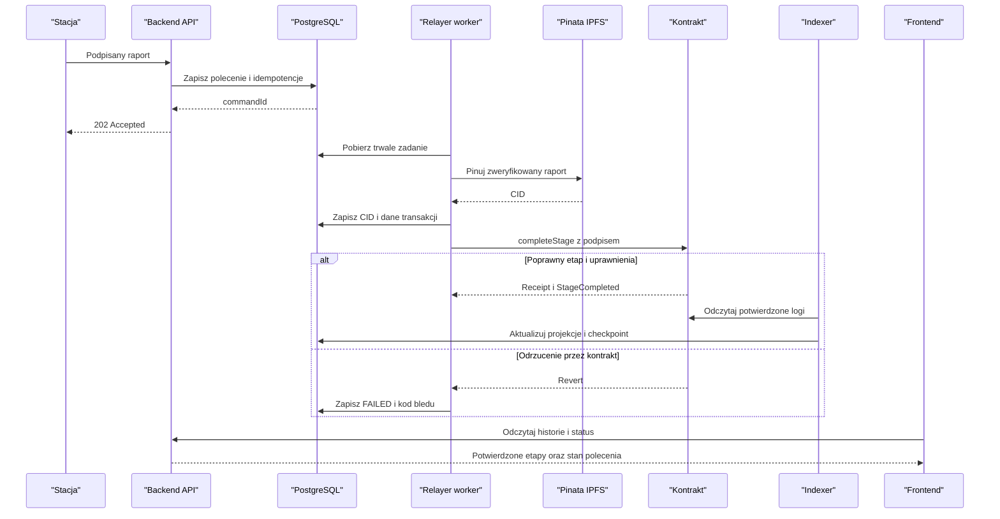

# Protokół integracji v1 - projekt do wspólnego zatwierdzenia

## Zanim powstanie kod

To proponowany kontrakt integracji, nie istniejące endpointy ani gotowy standard
projektu. Wszystkie cztery osoby powinny zatwierdzić go przed pisaniem klientów.
Zakres nadrzędny wyznacza [opis PDF](source-alignment.md).
Wymagane są certyfikat stacji i dwa niezależne klucze do zamknięcia kontroli:
stacji oraz operatora zmiany. Otwarty pozostaje format i sposób powiązania
tych dowodów, a nie możliwość pominięcia drugiego klucza.
Wybrana ogólna marszruta to przygotowanie -> montaż -> kontrola -> pakowanie,
opisana w [regułach produkcji](production-rules.md) jako stageId 0..3.
Do zatwierdzenia pozostają profile pomiarów, parametry finalności/czasu
i wykonawcze warianty auth/certyfikatów/approval. Nie stosuj fikcyjnych
progów ani ukrytego domyślnego PASS.

Zapisz implementowalne schematy w [shared/schemas](../shared/schemas/README.md).
Identyczny testowy raport ma dać identyczny hash w Pythonie, Javie i TypeScript.

## Raport i typy

Raport v1 zawiera `schemaVersion` (stała `1`), `batchId`, `stageId`,
`stationAddress`, `timestamp`, `measurements`, `qaPassed`.

| Pole | Reprezentacja |
|---|---|
| `batchId` | `bytes32`, tekst `0x` z dokładnie 64 znakami hex; nie dowolna nazwa produktu |
| `stageId` | liczba całkowita zgodna z `uint32`, z uzgodnionej listy etapów |
| `stationAddress` | adres EVM; w kanonicznym raporcie małe litery z prefiksem `0x` |
| `timestamp`, `deadline` | Unix time w sekundach, nie milisekundach |
| `measurements` | obiekt dozwolonych pomiarów; ustalone klucze, jednostki i zakresy |
| `qaPassed` | boolean, podpisany wynik stacji; nie decyzja ręcznego QA |
| `nonce` | w HTTP dziesiętny string, na łańcuchu `uint256` |
| `reportHash` | Keccak-256 kanonicznych bajtów raportu, `bytes32` |
| `signature` | podpis EIP-712: 65 bajtów zapisanych jako hex z `0x` |
| `ipfsCid` | zweryfikowany CID z Pinaty, bez URL bramki |

Użyj całkowitych jednostek pomiarowych, np. `temperatureMilliC`, `torqueMilliNm`
i `pressurePa`. Ich konkretne zakresy trzeba zatwierdzić. Nie używaj
niejednoznacznych floatów, NaN, Infinity ani dowolnych pól JSON. Liczby JSON
ogranicz do bezpiecznych liczb całkowitych; duże liczniki przenoś jako string.
Modele Pydantic/DTO mają odrzucać nieznane pola i niejawne konwersje typów.
Wymienione jednostki są przykładami, nie wymaganymi pomiarami wszystkich
czterech etapów. W v1 proponujemy jeden zamrożony zestaw profili na wdrożenie;
brak zatwierdzonego profilu jest blokadą walidatora, nie pustym raportem PASS.

## Kanonizacja i IPFS

1. Zweryfikuj raport względem schematu; jawnie znormalizuj adres przed podpisem.
2. Utwórz bajty UTF-8 według RFC 8785 (JSON Canonicalization Scheme).
   Samo sortowanie kluczy lub domyślny serializer nie gwarantuje JCS.
3. Oblicz **Keccak-256**, nie NIST SHA3-256.
4. Pinuj ten sam raport; przy odczycie pobierz JSON, waliduj, kanonizuj i
   porównaj hash z wartością zapisaną on-chain.

CID może być inny niż hash raportu (kodowanie i struktura IPFS). Nie porównuj
bezpośrednio tekstu CID do `reportHash`.

Stacja nie zna jeszcze CID podczas podpisywania. Dlatego nie podpisuje go
w tym wariancie protokołu. Kontrakt przyjmuje osobno `ipfsCid` od uprawnionego
relayera i zapisuje podpisany `reportHash`. Nie może sprawdzić treści IPFS.
Złośliwy relayer może wskazać błędny CID; klient wykrywa to porównaniem hashy.
Jeśli CID też musi być kryptograficznie zatwierdzony przez stację, potrzebny jest
drugi krok podpisu po pinowaniu i zmiana tego protokołu we wszystkich modułach.

## EIP-712

Proponowana domena:

| Pole | Wartość |
|---|---|
| `name` | `SupplyChain` |
| `version` | `1` |
| `chainId` | `31337` lokalnie przy domyślnej konfiguracji Anvil; `80002` dla Amoy |
| `verifyingContract` | rzeczywisty adres wdrożonego kontraktu |

Primary type `StageCompletion`, **kolejność pól jest częścią specyfikacji**:

```solidity
StageCompletion(
    bytes32 batchId,
    uint32 stageId,
    bytes32 reportHash,
    bool qaPassed,
    uint256 nonce,
    uint256 deadline
)
```

To zapis pól do implementacji EIP-712, nie gotowa deklaracja Solidity.
Type string musi być dokładnie:
`StageCompletion(bytes32 batchId,uint32 stageId,bytes32 reportHash,bool qaPassed,uint256 nonce,uint256 deadline)`.

Podpisuje klucz stacji. Adres odzyskany z podpisu musi równać się
`report.stationAddress` oraz mieć `STATION_ROLE`. Backend sprawdza też, że
`batchId`, `stageId` i `qaPassed` w danych podpisanych odpowiadają raportowi.
Nonce jest osobnym licznikiem **dla adresu stacji w danym kontrakcie**,
nie nonce konta relayera. Kontrakt sprawdza oczekiwaną wartość i zużywa ją tylko
przy poprawnym przejściu. Deadline weryfikuj także on-chain.

Nie używaj `personal_sign`/`encode_defunct` jako zamiennika EIP-712.
Zmiana domeny, sieci, kontraktu, etapu, QA lub skrótu ma unieważnić podpis.

## Planowane API

Wszystkie ścieżki są wersjonowane przez `/api/v1`. Tworzenie i zmiana stanu
to polecenia asynchroniczne. Schemat OpenAPI ma opisywać wszystkie odpowiedzi.

| Metoda | Ścieżka | Znaczenie / odpowiedź |
|---|---|---|
| `POST` | `/api/v1/batches` | autoryzowane utworzenie partii, `202 CommandAccepted` |
| `GET` | `/api/v1/batches/{batchId}` | projekcja partii, `200 BatchResponse`, brak: `404` |
| `GET` | `/api/v1/batches/{batchId}/history` | historia z CID, reportHash, tx hash i statusem potwierdzenia |
| `POST` | `/api/v1/batches/{batchId}/stages` | podpisana telemetria, `202 CommandAccepted` |
| `GET` | `/api/v1/commands/{commandId}` | status polecenia, `200 CommandStatus`, brak: `404` |

Treść zgłoszenia etapu:

```text
StageSubmissionRequest {
  report: TelemetryReport,
  stationCertificateId: registered certificate identifier,
  reportHash: hex bytes32,
  nonce: decimal string,
  deadline: integer Unix seconds,
  signature: hex
}
```

`batchId` w ścieżce musi zgadzać się z raportem. Domena EIP-712 pochodzi
z konfiguracji danej sieci, nie z dowolnej domeny dostarczonej przez klienta.
`202` zwraca `commandId` i adres odczytu statusu. Nie zwraca fikcyjnego `txHash`.
Certyfikat jest uprzednio rejestrowany i weryfikowany; jego ID jest poza
raportem JCS. Adres certyfikatu musi odpowiadać signerowi raportu.
Zasady wystawienia, ważności i odwołania opisuje [station-identity](station-identity.md).
Publiczny paszport nie udostępnia wewnętrznych błędów relayera, surowych podpisów
ani danych administracyjnych. Endpoint statusu polecenia wymaga uprawnienia
właściciela/obsługi, nie jest publiczny tylko dlatego, że identyfikator to UUID.

Do historii dodaj ograniczoną paginację i stabilne sortowanie według pozycji
zdarzenia na łańcuchu. Nie mieszaj niepotwierdzonych poleceń z ukończonymi etapami.

Precyzyjne prawa do endpointów, owner, propozycję SIWE/cookie/CSRF i rozdzielenie
podpisanego POST od prywatnego GET opisuje [access-control](access-control.md).
Nie nazywaj ogólnie „obsługą” wszystkich ról: QA widzi kandydatów, a status
command jest dla właściciela lub aktualnego administratora.

## Status i błędy

Minimalne statusy polecenia:
`ACCEPTED -> PINNING -> READY_TO_SUBMIT -> SUBMITTED -> CONFIRMED`.
Etap wymagający współzatwierdzenia operatora przechodzi po pinowaniu przez
`WAITING_FOR_QA`, a dopiero po uzyskaniu drugiego dowodu do `READY_TO_SUBMIT`.
CREATE_BATCH pomija pinowanie i QA. Pełne warianty i recovery opisuje
[model stanów](data-model.md); API/UI muszą obsługiwać każdy z tych statusów.
Niepowodzenie oznacz jako `FAILED` z kodem błędu; zaplanowane ponowienie ma
zachować aktualny etap i jawne `retryAt`. Brak dostępności nie oznacza sukcesu.
Reorganizacja może cofnąć pozorne potwierdzenie do ponownej weryfikacji.

| HTTP | Znaczenie |
|---|---|
| `400` | niepoprawny format, schemat lub niespójne pola |
| `401` | brak wymaganego uwierzytelnienia |
| `403` | zły podpis lub brak roli/uprawnienia |
| `404` | nieznana partia/polecenie |
| `409` | konflikt etapu, nonce lub idempotency key |
| `422` | negatywny wynik QA / raport poza dozwoloną regułą |
| `503` | backend nie może trwale przyjąć polecenia |

Błędy API zwracaj jako `application/problem+json` ze stabilnym kodem domenowym
i identyfikatorem korelacji. Szczegóły RPC, JWT i stack trace zostają poza
odpowiedzią. Walidacja wstępna nie usuwa ryzyka późniejszego revertu kontraktu;
taki wynik zapisz jako błąd polecenia.

## Idempotencja i dwa różne nonce

Dla zgłoszenia etapu zapisz unikalność `(chainId, contractAddress, stationAddress, nonce)`.
Powtórzenie identycznej treści podpisywanej zwraca istniejący `commandId`.
Inna treść z tą samą tożsamością daje `409`. Dla tworzenia partii użyj
`Idempotency-Key`, zakresu użytkownika i skrótu treści żądania.

Stacja nie wysyła dwóch nowych raportów jednocześnie z tym samym nonce.
Po timeout sprawdza status lub ponawia identyczne żądanie. Po trwałym błędzie
konieczne jest jawne uzgodnienie wznowienia; nie usuwaj automatycznie wpisu
idempotencji, nie zwiększaj nonce stacji bez sprawdzenia kontraktu.
Na życzenie użytkownika mechanizm DEC-09 nie został wybrany.
[Corrections](corrections.md) porównuje alternatywy, ich zmiany w ABI/DB
i zagrożenie starym podpisem. Sam nowy deadline lub nowy hash nie daje prawa
do zastąpienia poprzedniej autoryzacji.

Relayer ma niezależny nonce transakcyjny konta EVM. Jeden writer przydziela
go dla danego `(chainId, relayerAddress)`. Samo `@Async` lub równoległe
`FastRawTransactionManager` nie zapewnia globalnej synchronizacji.
Zapisuj hash i parametry podpisanej transakcji przed wysłaniem. Nieznany wynik
RPC wymaga odszukania tej transakcji; replacement korzysta z tego samego nonce
i tej samej operacji. Retry nie może wykonać podwójnego przejścia.

## Projekt interfejsu kontraktu

Przewidywane operacje: `createBatch`, `completeStage`, odczyt nonce stacji
i stanu partii, przypisanie ról, zatwierdzenie konkretnego raportu przez
operatora zmiany z uprawnieniem QA.
`completeStage` przyjmuje pola podpisanej struktury, osobno CID i podpis.
Zdarzenie `StageCompleted` zawiera co najmniej `batchId`, `stageId`,
`stationAddress`, `reportHash` i `ipfsCid`. Ręczne QA emituje osobne zdarzenie.
Dokładne ABI musi powstać z kompilatora, a nie z ręcznie napisanego JSON.

### Dwa klucze przy zamknięciu kontroli

Wariant do zatwierdzenia: operator zmiany wysyła swoim portfelem podpisaną
transakcję `approveStage(batchId, stageId, reportHash)`. Kontrakt przechowuje
adres zatwierdzającego związany z tą trójką. `completeStage` odzyskuje adres
stacji z EIP-712, sprawdza jego rolę i dla etapu kontroli wymaga approval
od **innego** adresu z aktualnym uprawnieniem operatora QA.
Rejestrowanie jedynie boolean approval bez adresu nie wystarczy do sprawdzenia
niezależności obu kluczy. Cofnięcie roli przed zamknięciem blokuje approval.
Oba dowody autoryzują ten sam hash; pozytywnego wyniku stacji nie można
zastąpić decyzją człowieka. Nie jest to portfel multisig ani obowiązek
podpisania jednej transakcji przez dwa konta.
Przepływ i proponowane endpointy kolejki/auth są w [flows](flows.md).
Szczegóły wiązania approval, jego powtórzeń, roli i ograniczeń odwołania
są w [quality-approval](quality-approval.md). Approval zatwierdza raport,
nie nonce/deadline jego obwiedni. Zmiana tego zakresu wymaga zmiany ABI,
nie jedynie nowej etykiety w panelu.

### Minimalny zapis on-chain

Pełny JSON i certyfikat zostają off-chain. On-chain zapisuj identyfikator partii,
CID/hash oraz wyłącznie stan potrzebny maszynie/RBAC/replay/approval.
Nie duplikuj nieograniczonej historii raportów w storage: do historii służą
minimalne eventy i indexer. Podpisy mogą być calldata do weryfikacji, ale nie
przechowuj ich kopii w stanie kontraktu. CID i reportHash mają różne funkcje
opisane wyżej; dodatkowy hash integralności jest uzasadnionym metadanym,
nie pretekstem do przechowywania pomiarów.

## Skrócony przepływ etapu bez bramki operatora

Ten diagram pokazuje wariant bez ręcznej kontroli. Obowiązkową współautoryzację
zamknięcia etapu kontroli pokazuje [diagram QA](flows.md).

<!-- mermaid-checked: every participant uses `participant Id as "Label"`, no \n in aliases/messages/notes, every alt/opt/loop closed by end, no `:` inside any alias -->

