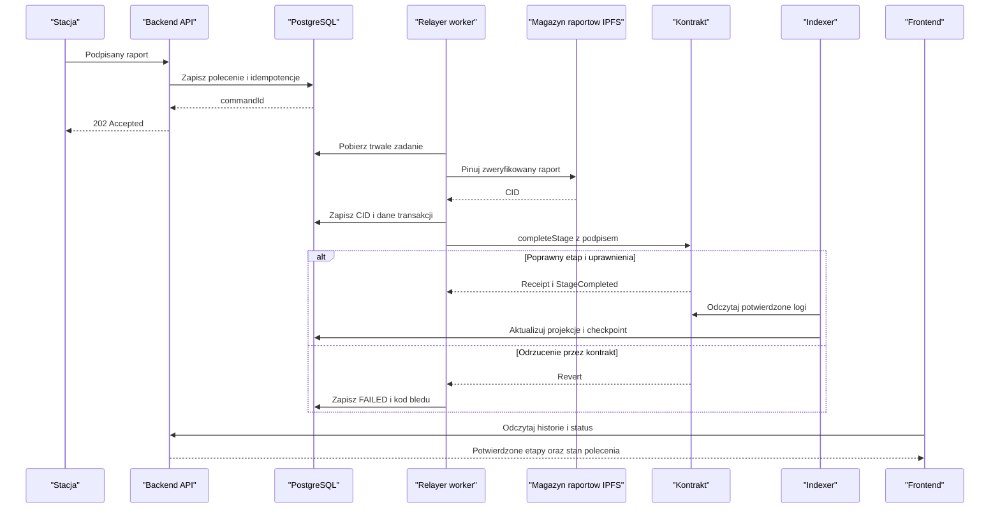

# Protokół integracji v1 (zmiany v2) - kontrakt integracji

## Zanim powstanie kod

To kontrakt integracji po zmianach [v2](changes-v2.md), nie istniejące endpointy.
Wszystkie cztery osoby potwierdzają go na spotkaniu startowym przed pisaniem klientów.
Zakres nadrzędny wyznacza [opis PDF](source-alignment.md).
Wymagane są certyfikat stacji i dwa niezależne klucze do zamknięcia kontroli:
stacji (`StageCompletion`) i operatora zmiany (`StageApproval`).
Wybrana ogólna marszruta to przygotowanie -> montaż -> kontrola -> pakowanie,
opisana w [regułach produkcji](production-rules.md) jako stageId 0..3.
Do zatwierdzenia pozostają profile pomiarów (DEC-02) oraz wartości czasu i
potwierdzeń (DEC-07/11). Nie stosuj fikcyjnych progów ani ukrytego domyślnego PASS.

Zapisz implementowalne schematy w [shared/schemas](../shared/schemas/README.md).
Identyczny testowy raport ma dać identyczny hash w Pythonie, Javie i TypeScript.

## Raport i typy

Raport v1 zawiera `schemaVersion` (stała `1`), `batchId`, `stageId`,
`stationAddress`, `timestamp`, `measurements`, `qaPassed`.

| Pole | Reprezentacja |
|---|---|
| `batchNumber` | tekst `B-RRRR-NNNN` (np. `B-2026-0001`), nadawany przez backend; widoczny w QR i UI |
| `batchId` | `bytes32` = `keccak256(utf8(batchNumber))`, tekst `0x` z dokładnie 64 znakami hex; liczony też on-chain w `createBatch` |
| `stageId` | liczba całkowita zgodna z `uint32`, z uzgodnionej listy etapów |
| `stationAddress` | adres EVM; w kanonicznym raporcie małe litery z prefiksem `0x` |
| `timestamp`, `deadline` | Unix time w sekundach, nie milisekundach |
| `measurements` | obiekt dozwolonych pomiarów; ustalone klucze, jednostki i zakresy |
| `qaPassed` | boolean, podpisany wynik stacji; nie decyzja ręcznego QA |
| `deadline`, `approvalDeadline` | Unix seconds (`uint256`); w HTTP liczba całkowita; kontrakt ogranicza `deadline` do `block.timestamp + maxDeadlineWindow` |
| `reportHash` | Keccak-256 kanonicznych bajtów raportu, `bytes32` |
| `signature`, `approvalSignature` | podpis EIP-712: 65 bajtów zapisanych jako hex z `0x` |
| `ipfsCid` | zweryfikowany CID z magazynu raportów (CIDv0 lub CIDv1), bez URL bramki |

Nonce stacji **nie istnieje** (V2-01). Dlatego pole nie występuje ani w raporcie,
ani w podpisanej strukturze, ani w HTTP.

Użyj całkowitych jednostek pomiarowych, np. `temperatureMilliC`, `torqueMilliNm`
i `pressurePa`. Ich konkretne zakresy trzeba zatwierdzić. Nie używaj
niejednoznacznych floatów, NaN, Infinity ani dowolnych pól JSON. Liczby JSON
ogranicz do bezpiecznych liczb całkowitych; duże liczniki przenoś jako string.
Modele Pydantic/DTO mają odrzucać nieznane pola i niejawne konwersje typów.
Wymienione jednostki są przykładami, nie wymaganymi pomiarami wszystkich
czterech etapów. W v1 proponujemy jeden zamrożony zestaw profili na wdrożenie;
brak zatwierdzonego profilu jest blokadą walidatora, nie pustym raportem PASS.

## Kanonizacja i IPFS

1. Zweryfikuj raport względem schematu; jawnie znormalizuj adres przed podpisem.
2. Utwórz bajty UTF-8 według RFC 8785 (JSON Canonicalization Scheme).
   Samo sortowanie kluczy lub domyślny serializer nie gwarantuje JCS.
3. Oblicz **Keccak-256**, nie NIST SHA3-256.
4. Zapisz w magazynie raportów **dokładnie te bajty JCS jako plik** (nie obiekt JSON
   do serializacji przez usługę); przy odczycie pobierz JSON, waliduj, kanonizuj i
   porównaj hash z wartością zapisaną on-chain. Walidator CID przyjmuje CIDv0 i CIDv1.

CID może być inny niż hash raportu (kodowanie i struktura IPFS). Nie porównuj
bezpośrednio tekstu CID do `reportHash`.

Stacja nie zna jeszcze CID podczas podpisywania. Dlatego nie podpisuje go
w tym wariancie protokołu. Kontrakt przyjmuje osobno `ipfsCid` od uprawnionego
relayera i zapisuje podpisany `reportHash`. Nie może sprawdzić treści IPFS.
Złośliwy relayer może wskazać błędny CID; klient wykrywa to porównaniem hashy.
Jeśli CID też musi być kryptograficznie zatwierdzony przez stację, potrzebny jest
drugi krok podpisu po pinowaniu i zmiana tego protokołu we wszystkich modułach.

## EIP-712

Proponowana domena:

| Pole | Wartość |
|---|---|
| `name` | `SupplyChain` |
| `version` | `1` |
| `chainId` | `31337` lokalnie przy domyślnej konfiguracji Anvil; `80002` dla Amoy |
| `verifyingContract` | rzeczywisty adres wdrożonego kontraktu |

Primary type `StageCompletion`, **kolejność pól jest częścią specyfikacji**:

```solidity
StageCompletion(
    bytes32 batchId,
    uint32 stageId,
    bytes32 reportHash,
    bool qaPassed,
    uint256 deadline
)
```

To zapis pól do implementacji EIP-712, nie gotowa deklaracja Solidity.
Type string musi być dokładnie:
`StageCompletion(bytes32 batchId,uint32 stageId,bytes32 reportHash,bool qaPassed,uint256 deadline)`.

Podpisuje klucz stacji. Adres odzyskany z podpisu musi równać się
`report.stationAddress` i być aktywną stacją w rejestrze on-chain
(ważność `expiresAt` i `stageMask` obejmujące `stageId`). Backend sprawdza też, że
`batchId`, `stageId` i `qaPassed` w danych podpisanych odpowiadają raportowi.
Ochrona przed replay (bez nonce): etap `(batchId, stageId)` kończy się raz,
`deadline` jest sprawdzany on-chain i ograniczony przez `maxDeadlineWindow`,
a domena wiąże podpis z siecią i kontraktem.

Drugi typ, podpisywany przez operatora zmiany (etap kontroli, `qaPassed=true`),
w tej samej domenie:

```solidity
StageApproval(
    bytes32 batchId,
    uint32 stageId,
    bytes32 reportHash,
    uint256 deadline
)
```

Type string: `StageApproval(bytes32 batchId,uint32 stageId,bytes32 reportHash,uint256 deadline)`.
W kontrakcie wartość `deadline` przekazywana jako `approvalDeadline`.

Nie używaj `personal_sign`/`encode_defunct` jako zamiennika EIP-712 dla tych typów.
Zmiana domeny, sieci, kontraktu, etapu, QA lub skrótu ma unieważnić podpis.
Typy `StageCompletion`, `StageApproval` i `StationCertificate` mają różne type hashes,
więc podpisu jednego nie użyje się jako drugiego. Login SIWE używa EIP-191.
Implementacje EIP-712 w Javie są ręczne (jedna stała struktura), a poprawność
potwierdza wspólny wektor w Pythonie, Javie, TS i Solidity.

## Planowane API

Wszystkie ścieżki są wersjonowane przez `/api/v1`. Tworzenie i zmiana stanu
to polecenia asynchroniczne. Schemat OpenAPI ma opisywać wszystkie odpowiedzi.

| Metoda | Ścieżka | Znaczenie / odpowiedź |
|---|---|---|
| `POST` | `/api/v1/auth/challenges` | wiadomość SIWE do podpisu (challenge jednorazowy) |
| `POST` | `/api/v1/auth/sessions` | podpisany challenge -> `200` z tokenem Bearer; `DELETE /api/v1/auth/sessions/current` wylogowuje |
| `POST` | `/api/v1/batches` | autoryzowane utworzenie partii (`Idempotency-Key`), `202 CommandAccepted`; wynik zawiera `batchNumber` i `batchId` |
| `GET` | `/api/v1/batches/{batchId}` | projekcja partii, `200 BatchResponse`, brak: `404` |
| `GET` | `/api/v1/batch-numbers/{batchNumber}` | to samo po numerze `B-RRRR-NNNN` (QR, ręczne wpisanie) |
| `GET` | `/api/v1/batches/{batchId}/history` | historia (ukończone i odrzucone etapy) z CID, reportHash, tx hash i statusem potwierdzenia |
| `POST` | `/api/v1/batches/{batchId}/stages` | podpisana telemetria, `202 CommandAccepted` (także dla `qaPassed=false`) |
| `GET` | `/api/v1/commands/{commandId}` | status polecenia, `200 CommandStatus` (`outcome`, `retryAllowedAfter`), brak: `404` |
| `GET` | `/api/v1/qa/candidates` | lista kandydatów WAITING_FOR_QA (rola QA) |
| `GET` | `/api/v1/qa/candidates/{commandId}` | szczegóły kandydata |
| `POST` | `/api/v1/qa/candidates/{commandId}/approval` | podpis `StageApproval` operatora (`approvalDeadline`, `signature`), `200` lub `409` |

Treść zgłoszenia etapu:

```text
StageSubmissionRequest {
  report: TelemetryReport,
  stationCertificateId: registered certificate identifier,
  reportHash: hex bytes32,
  deadline: integer Unix seconds,
  signature: hex
}
```

`batchId` w ścieżce musi zgadzać się z raportem. Domena EIP-712 pochodzi
z konfiguracji danej sieci, nie z dowolnej domeny dostarczonej przez klienta.
`202` zwraca `commandId` i adres odczytu statusu. Nie zwraca fikcyjnego `txHash`.
Certyfikat jest uprzednio rejestrowany i weryfikowany; jego ID jest poza
raportem JCS. Adres certyfikatu musi odpowiadać signerowi raportu i aktywnej
rejestracji stacji on-chain.
Zasady wystawienia, ważności i odwołania opisuje [station-identity](station-identity.md).
Publiczny paszport nie udostępnia wewnętrznych błędów relayera, surowych podpisów
ani danych administracyjnych. Endpoint statusu polecenia wymaga uprawnienia
właściciela/obsługi, nie jest publiczny tylko dlatego, że identyfikator to UUID.

Do historii dodaj ograniczoną paginację i stabilne sortowanie według pozycji
zdarzenia na łańcuchu. Nie mieszaj niepotwierdzonych poleceń z ukończonymi etapami.

Uwierzytelnienie: token Bearer w nagłówku `Authorization` (SIWE tylko do jego
wydania, brak cookie i CSRF). Precyzyjne prawa do endpointów, owner i rozdzielenie
podpisanego POST od prywatnego GET opisuje [access-control](access-control.md).
Nie nazywaj ogólnie „obsługą” wszystkich ról: QA widzi kandydatów, a status
command jest dla właściciela lub aktualnego administratora.

## Status i błędy

Minimalne statusy polecenia:
`ACCEPTED -> PINNING -> READY_TO_SUBMIT -> SUBMITTED -> CONFIRMED`.
Etap wymagający współzatwierdzenia operatora przechodzi po pinowaniu przez
`WAITING_FOR_QA`, a dopiero po zapisaniu ważnego `StageApproval` do `READY_TO_SUBMIT`.
CREATE_BATCH pomija pinowanie i QA. Raport z `qaPassed=false` pomija QA i po
potwierdzeniu `StageRejected` kończy `CONFIRMED` z `outcome=REJECTED`.
Pełne warianty i recovery opisuje
[model stanów](data-model.md); API/UI muszą obsługiwać każdy z tych statusów.
Niepowodzenie oznacz jako `FAILED` z kodem błędu; zaplanowane ponowienie ma
zachować aktualny etap i jawne `retryAt`, a wznowienie nowego raportu - `retryAllowedAfter`.
Brak dostępności nie oznacza sukcesu.
Reorganizacja może cofnąć pozorne potwierdzenie do ponownej weryfikacji.

| HTTP | Znaczenie |
|---|---|
| `400` | niepoprawny format, schemat lub niespójne pola |
| `401` | brak wymaganego uwierzytelnienia |
| `403` | zły podpis, stacja nieaktywna/wygasła/poza zakresem lub brak roli |
| `404` | nieznana partia/polecenie |
| `409` | konflikt etapu, aktywnego polecenia (`STAGE_ALREADY_PENDING`), approval lub idempotency key |
| `422` | raport niespójny z profilem pomiarów albo poza dozwoloną regułą |
| `429` | limit żądań |
| `503` | backend nie może trwale przyjąć polecenia |

Błędy API zwracaj jako `application/problem+json` ze stabilnym kodem domenowym
i identyfikatorem korelacji. Szczegóły RPC, tokenów i stack trace zostają poza
odpowiedzią. Walidacja wstępna nie usuwa ryzyka późniejszego revertu kontraktu;
taki wynik zapisz jako błąd polecenia.

## Idempotencja i reguła zastępowania (bez nonce stacji)

Tożsamość zamiaru stacji to **digest EIP-712 `StageCompletion`**
(`signed_payload_digest`), zapisany z `(chainId, contractAddress)`.
Powtórzenie identycznej treści zwraca istniejący `commandId`. Dla tego samego
`(deployment, batchId, stageId)` obowiązuje
[reguła zastępowania](corrections.md): aktywne polecenie z innym hashem daje
`409 STAGE_ALREADY_PENDING`, a nowy raport po FAILED jest dozwolony dopiero gdy
stary deadline minął w potwierdzonym bloku. Dla tworzenia partii użyj
`Idempotency-Key`, zakresu użytkownika i skrótu treści żądania.

Po timeout stacja sprawdza status lub ponawia identyczne żądanie. Nie usuwaj
wpisu idempotencji, by „odblokować” stację. DEC-09 jest zamknięta
(wariant C uproszczony, [corrections](corrections.md)).

Relayer ma niezależny nonce transakcyjny konta EVM. Jeden writer przydziela
go dla danego `(chainId, relayerAddress)`. Samo `@Async` lub równoległe
`FastRawTransactionManager` nie zapewnia globalnej synchronizacji.
Zapisuj hash i parametry podpisanej transakcji przed wysłaniem; transakcję
podpisuje własny kod (Web3j do kodowania wywołania i podpisu, **bez `.send()`**
i bez `DefaultGasProvider`). Opłaty: EIP-1559 z konfigurowalnym minimalnym
priority fee (Polygon wymaga wysokiego progu - zweryfikuj wartość dla Amoy).
Nieznany wynik RPC wymaga odszukania tej transakcji i ponownego wysłania
identycznych bajtów. Fee-bump/replacement nie jest zaimplementowany w MVP;
zablokowana transakcja to procedura ręczna. Retry nie może wykonać
podwójnego przejścia.

## Projekt interfejsu kontraktu

Powierzchnię kontraktu (funkcje, zdarzenia, reguły `completeStage`) opisuje
[changes-v2](changes-v2.md); poniżej skrót. Dokładne ABI musi powstać z kompilatora
(`forge inspect`), a nie z ręcznie napisanego JSON.

- `createBatch(string batchNumber)` (RELAYER_ROLE): `batchId = keccak256(batchNumber)`.
- `completeStage(batchId, stageId, reportHash, qaPassed, deadline, ipfsCid,
  stationSignature, approvalDeadline, approvalSignature)` (RELAYER_ROLE).
- `registerStation`/`revokeStation`/`setMaxDeadlineWindow` (admin); odczyty
  `getBatch`, `getStation`.
- Zdarzenia: `BatchCreated`, `StageCompleted` (z `qaOperator`), `StageRejected`,
  `StationRegistered`, `StationRevoked`; `batchId` indeksowany, aby paszport mógł
  niezależnie przeszukać logi przez RPC.
- `qaPassed=false` nie przesuwa partii i emituje `StageRejected` (ślad odrzucenia).

### Dwa klucze przy zamknięciu kontroli

Operator zmiany podpisuje portfelem EIP-712 `StageApproval` dla konkretnego
`(batchId, stageId, reportHash, deadline)`. Backend zbiera podpis
(`POST /api/v1/qa/candidates/{commandId}/approval`), a relayer przekazuje go razem
z podpisem stacji do `completeStage`. Dla etapu kontroli (`stageId == 2`, `qaPassed=true`)
kontrakt wymaga ważnego approval operatora z aktualną QA_INSPECTOR_ROLE i adresem
**różnym** od stacji. Oba dowody autoryzują ten sam hash; pozytywnego wyniku stacji
nie zastąpi decyzja człowieka. Nie ma transakcji `approveStage`, stanu approval
w storage ani portfela multisig; operator nie płaci gazu.
Szczegóły: [quality-approval](quality-approval.md), przepływ: [flows](flows.md).
Approval wiąże raport (hash), nie pojedynczą próbę wysyłki, i wygasa po swoim deadline.

### Minimalny zapis on-chain

Pełny JSON i certyfikat zostają off-chain. On-chain zapisuj: istnienie partii
i `nextStage`/`completed`, rejestr stacji (`active`, `expiresAt`, `stageMask`),
role, skróty odrzuceń (by nie powielać zdarzeń) i parametr okna deadline.
Nie duplikuj nieograniczonej historii raportów w storage: do historii służą
zdarzenia i indexer. Podpisy są calldata do weryfikacji, nie przechowuj ich kopii
w stanie. CID i reportHash mają różne funkcje opisane wyżej.

## Skrócony przepływ etapu bez bramki operatora

Ten diagram pokazuje wariant bez ręcznej kontroli. Obowiązkową współautoryzację
zamknięcia etapu kontroli pokazuje [diagram QA](flows.md).

<!-- mermaid-checked: every participant uses `participant Id as "Label"`, no \n in aliases/messages/notes, every alt/opt/loop closed by end, no `:` inside any alias -->

